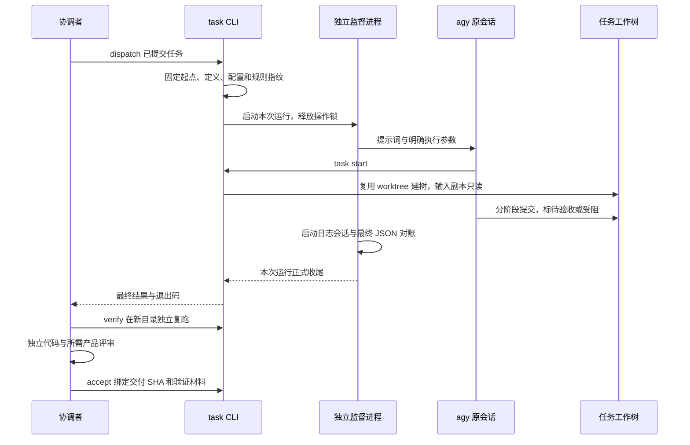

# 任务协作

> 基准：0.6.0 + task 实现 / 2026-10-14

协调者为 cancel-buy 写任务文件，列出“取消不扣款”的目标、允许修改的文件和复跑命令。任务提交后，`nexus-devflow task dispatch cancel-buy` 固定起始提交与定义指纹。agy 读取文件，通过工具自身的 `task start` 在固定提交建树，按输入指纹准备只读副本，在指定树里修改并提交。执行者只能把任务标为待验收或受阻。

协调者随后运行 `task verify`。工具检查输入、白名单、工作副本和交付提交，在新的空目录执行登记命令。代码独立审查通过后，协调者提供绑定同一提交的审查 JSON，再运行 `task accept`。任务涉及产品行为时，审查 JSON 还必须有独立产品评审通过记录。accept 提交任务的通过登记，并分别保存被验证提交和验收登记提交。集成与回收继续走宿主自己的工作树规则。

## 定义、运行与验收各存什么

任务 Markdown 是目标、范围、输入、前置、白名单、复跑命令和人工进度的唯一来源。机器字段位于唯一的 task-config JSON 块，模型与时间预算可以覆盖宿主默认值。字段与校验以 `packages/devflow/src/task/definition.ts` 为准，不在文档复制类型清单。

宿主默认值只来自 `nexus.config.json` 的 task 段。没有 task 段不影响普通 devflow 命令；task 命令要求先接入。当前唯一执行器是 agy，执行参数和权限参数由宿主显式配置。配置字段以 `task/config.ts` 为准，外部 JSON 先读成 unknown 后校验。密钥经环境变量传入，不能进入配置、任务文件和提示词。

本地控制目录保存定义快照、每次运行、原始日志、独立验证材料和正式验收记录。目录必须由 Git 忽略，不能把新运行写成主仓未提交改动。快照保存定义、配置、规则指纹和固定起点；原任务定义或这些文件变化时，旧快照不再可直接执行。version 2 快照由当前工具读写；旧版本不自动改写，也不靠 refresh-definition 掩盖工具格式升级。

正式验收引用通过的验证材料及其指纹。最近复跑索引只表示最近一次复跑；例如任务通过后再运行一次不符合待验收状态的 verify，最近复跑会失败，但正式验收引用仍保留。status 分列任务状态、进程结果、最近复跑和正式验收。执行器报告失败也不否定协调者随后独立复跑通过的成果。工作树回收后，当前 HEAD 无法对账；验收登记提交进入主干时，显示为历史已集成，不冒充当前工作副本重新通过测试。

## 工作树与路径

task 使用 devflow 的 worktree 模块建树，固定起始提交并核对实际树位置。task.worktreeDir 为仓库内相对目录时，任务树位于该目录的任务标识子目录；为 null 时，位于主仓同级的 `<仓库名>-worktrees/<任务标识>`。路径根据主仓定位，从任务树内调用也指向同一现场。任务文件的 worktree 必须与隔离配置计算的路径一致，不能借任务输入任意指定仓库外目录。

任务树不继承普通 worktree.share 和 postCreate。任务树的 share 为空，task.postCreate 是宿主显式提供的准备命令。普通 worktree 命令仍使用自己的配置。任务树的输入以校验过的副本提供，不以可写共享目录交付。路径先解析实际位置，拒绝越界软链；验收输出的目录和文件不能是软链。只读权限和白名单核对是协作约束，不是操作系统沙箱。

## 等待、中断与原会话续跑

dispatch/resume 默认等待本次运行正式收尾；`--detach` 只启动。等待不占同任务操作锁，也不绑定可能被后来运行替换的 latest 索引。两个任务可各自等待，同任务重复派发、续跑或验收被拒绝。

INT/TERM 只取消调用方的等待，返回对应中断退出码，监督进程和执行器继续运行。监督进程单独管理显式硬期限和执行器进程组；首轮预算只是进度检查节点，不杀任务。真正终止后确认后代退出，才结束运行。没有正常收尾的监督进程被 status 和等待命令报告为中断，不留永久运行假象。

agy 适配器增量读取本次启动日志，只有创建会话和恢复会话记录可以提前登记 ID。半行、其他会话查询和未知格式不能冒充本次会话。最终 JSON 必须报告 SUCCESS，并与已登记会话一致。没有识别到启动日志格式时，工具用最终 JSON 登记，同时报告回退。resume 使用原记录的 conversation_id 和原工作树；原树缺失或原会话不明时报错，不暗开新会话。

rework 读取 defects、reproduce、criteria JSON，在原任务文件追加正式要求，只提交该任务文件。它要求原树干净、状态允许且没有活动执行进程，不自动 resume。范围变更先经宿主审批，在原树提交后通过 `--refresh-definition` 重新确认；原分支和树不能借此换名。旧定义另行留档，旧验证材料不能用于新定义。

CLI 默认 stdout 为 JSON，错误在 stderr 使用 `[task]` 前缀；help 和 status --short 为可读文本。完成交付退出 0，受阻退出 3，失败退出 1，取消等待返回 130/143。进程成功退出仍需协调者独立验证和审查。调用方的后台通知属于调用方能力，task 不向其他会话发送消息。

## 独立验证和依赖

verify 要求待验收状态、指定分支、固定起点的后续提交、干净工作副本、输入指纹一致和白名单内改动。Git 的 assume-unchanged、skip-worktree 会隐藏工作副本，验证前必须取消。越界诊断提供相关提交和只读查看命令，不自动撤回用户提交。

每次验证使用新目录，`{output}` 被替换为工具预先创建的空目录，命令也可从 TASK_VERIFY_OUTPUT 读取目录。命令必须接受空目录，不限定父目录；失败保存退出码、stdout/stderr 与 passed=false。命令不得改变 HEAD、受跟踪文件或输入。accept 再核对交付 SHA、定义、日志和产物指纹，代码变化后必须重验。工具只核对独立审查记录字段，不能核验审查者身份。

前置任务必须已有正式验收。前置树尚在时，检查其验收登记提交、未提交内容及会隐藏工作副本的索引标记；树已回收时，验收登记提交必须集成到主仓。前置指定的 commit 是被验证提交，不能用执行器退出码或不稳定的兄弟树内容代替依赖。

## 验证与取材

来源为 旧项目C 的 task-core、task-runtime、task-agy、公开 CLI 集成测试及实际任务记录。关键取材提交为 `0f35037`、`b5129c1`、`a13fd65`；原会话续跑见 parts-source 本地记录，独立返工验收见 magic-table-rework 的任务与 Git 记录。研究模型、ROM、Python 环境和研究复跑命令不属于公共实现。

`pnpm test:task` 用真实临时 Git 仓库、真实 devflow 工作树、可控外部执行器，通过构建后的公开 CLI 验证管线。c8 收集子进程的 task 构建产物覆盖率，四项门槛各为 80%；其他模块继续由 Vitest 统计。测试输出与 coverage/task 是统计出处。真实 agy 与真实宿主接入另行留证，假执行器不能证明真实执行器兼容。运行材料不随 Git 克隆提供；升级、集成、回收前按[接入规范](../规范/接入规范.md)归档。
