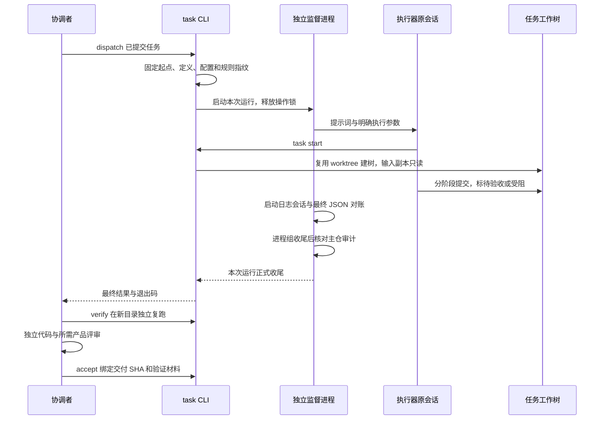

# 任务协作

> 基准：0.8.0 / 2026-10-19

协调者为 cancel-buy 写任务文件，列出“取消不扣款”的目标、允许修改的文件和复跑命令。任务提交后，`nexus-devflow task dispatch cancel-buy` 固定起始提交与定义指纹。默认执行器读取文件，通过工具自身的 `task start` 在固定提交建树，按输入指纹准备只读副本，在指定树里修改并提交。执行者只能把任务标为待验收或受阻。每轮交付时，执行者在任务文件「交付与验收记录」末尾追加交付摘要（改了什么、验证如何、还有什么，格式在规则模板里），最终回复复述同一份摘要并给交付 SHA。协调者照摘要逐条复跑，不必翻运行日志；工具不校验摘要是否存在。

`task new` 生成的任务文件按人读顺序排：一页摘要、背景与证据、已批准计划与授权、输入与操作步骤、验收清单、交付物与失败处理，然后才是任务配置 JSON 和执行记录、中断恢复、交付与验收记录。工具把认领、中断、返工等记录追加到文件末尾，所以交付与验收记录必须是最后一节。派发提示词只给任务路径、起点、工作树、目标、start 命令、授权边界和交付要求；其余规则只写在 task.rules 登记的规则文件里，提示词不复述。

协调者随后运行 `task verify`。工具检查输入、白名单、工作副本和交付提交，在新的空目录执行登记命令。代码独立审查通过后，协调者提供绑定同一提交的审查 JSON，再运行 `task accept`。任务涉及产品行为时，审查 JSON 还必须有独立产品评审通过记录。accept 提交任务的通过登记，并分别保存被验证提交和验收登记提交。集成与回收继续走宿主自己的工作树规则。



## 定义、运行与验收各存什么

任务 Markdown 是目标、范围、输入、前置、白名单、复跑命令和人工进度的唯一来源。机器字段位于唯一的 task-config JSON 块，模型与时间预算可以覆盖宿主默认值。字段与校验以 `packages/devflow/src/task/definition.ts` 为准，不在文档复制类型清单。

宿主默认值只来自 `nexus.config.json` 的 task 段。没有 task 段不影响普通 devflow 命令；task 命令要求先接入。task.executor 登记默认执行器名，task.executors 为每个执行器各留一段配置：启动命令、必填的模型和权限参数；agy 执行器另有 effort 与 mode 两个档位字段。只写了旧 task.agy 段的配置按“单执行器 agy”等价读取，executors 段存在时优先。task.executorEnvDeny 登记启动执行器前要剔除的环境变量名（默认空），协调者 shell 里的授权不会被执行器继承。任务文件的 execution 段可以覆盖默认执行器（execution.executor）与模型（execution.model）；effort 与 mode 只有 agy 执行器接受。dispatch 与 resume 的 `--model` 覆盖本次模型，已有快照时换模型必须同时 `--refresh-definition` 重新确认。执行器在 `task start` 建树前就失败时（比如模型限流），任务分支和工作树都还不存在，这时在主仓运行 `dispatch <任务标识> --refresh-definition --model <模型>` 归档旧快照并重派；分支已存在而工作树缺失时拒绝，现场交协调者处理。配置字段以 `task/config.ts` 为准，外部 JSON 先读成 unknown 后校验。密钥经环境变量传入，不能进入配置、任务文件和提示词。

本地控制目录保存定义快照、每次运行、原始日志、独立验证材料和正式验收记录。目录必须由 Git 忽略，不能把新运行写成主仓未提交改动。快照保存定义、配置、规则指纹和固定起点；原任务定义或这些文件变化时，旧快照不再可直接执行。version 2 快照由当前工具读写；旧版本不自动改写，也不靠 refresh-definition 掩盖工具格式升级。0.7.0 冻结的快照配置只有 agy 段，读取时规范成单执行器形状；配置指纹按 0.7.0 的形状另算一份比对，所以宿主 nexus.config.json 不改动时旧快照直接续跑。

status 逐个任务读取。某个任务的定义写坏或任务树切错分支时，只在该任务一行给出 error，其余任务照常显示；指定任务标识查询时，读取失败退出 1；task.rules 登记的规则文件不算任务。没有 task-config 块的旧任务文件只显示主仓里的状态头，标为历史，不读取旧工作树，也不能派发。正式验收引用通过的验证材料及其指纹。最近复跑索引只表示最近一次复跑；例如任务通过后再运行一次不符合待验收状态的 verify，最近复跑会失败，但正式验收引用仍保留。status 分列任务状态、进程结果、最近复跑和正式验收。执行器报告失败也不否定协调者随后独立复跑通过的成果。工作树回收后，当前 HEAD 无法对账；验收登记提交进入主干时，显示为历史已集成，不冒充当前工作副本重新通过测试。

## 工作树与路径

task 使用 devflow 的 worktree 模块建树，固定起始提交并核对实际树位置。task.worktreeDir 为仓库内相对目录时，任务树位于该目录的任务标识子目录；为 null 时，位于主仓同级的 `<仓库名>-worktrees/<任务标识>`。路径根据主仓定位，从任务树内调用也指向同一现场。任务文件的 worktree 必须与隔离配置计算的路径一致，不能借任务输入任意指定仓库外目录。

任务树不继承普通 worktree.share 和 postCreate。任务树的 share 为空，task.postCreate 是宿主显式提供的准备命令。普通 worktree 命令仍使用自己的配置。任务树的输入以校验过的副本提供，不以可写共享目录交付。输入在固定起点里没有提交时，start 把它复制进任务树，复制出的文件对 Git 是未跟踪文件。这类输入路径必须被 Git 忽略，否则任务树永远不干净，verify 无法通过；“已提交”以固定起点的 HEAD 为准，只暂存未提交的输入同样会被复制进树。dispatch 与 start 遇到不在 HEAD 中、也未被忽略的输入直接拒绝。路径先解析实际位置，拒绝越界软链；验收输出的目录和文件不能是软链。只读权限和白名单核对是协作约束，不是操作系统沙箱。

固定起点是任务首次派发或建树时登记的提交。例如任务从提交 A 建树，主仓把 A amend 成 B，任务树仍从 A 延续。任务交付即使通过输入、白名单和复跑检查，集成时也可能出现 add/add 冲突。dispatch（含 dry-run）、resume、verify、accept 都把固定起点与当前主仓 HEAD 对账。起点不是主仓 HEAD 的祖先时，工具在 stderr 告警，JSON 的 baseWarning 保存同一提示；运行、验证和验收记录保留本次检查结果。告警列出两个完整 SHA 和原树处理步骤，不改起点、不重写分支、不自动拒绝有效交付。记录中的告警对应检查时的主仓 HEAD，不是后续主仓状态的实时判断。Git 检查本身失败时命令报错，不能把检查失败当作没有告警。

集成前，协调者核对任务固定起点与最新主仓历史。已派发起点不要 amend、rebase 或用其他方式改写；修正内容使用新提交。历史已经改写时，先保留任务树与原始材料。如果任务已待验收，就先用 rework --message-file 登记基准改写原因、复现命令和重新验收标准；业务内容无缺陷也需要登记，因为当前交付基准需要调整。随后按宿主集成规则在原树变基到最新主仓。add/add 冲突逐文件核对两边；任务文件需要同时核对主仓定义与任务树执行记录，不能一律取分支整份。变基不适合保留现有任务记录时，由协调者核对后重放交付。原树对齐并提交后，在原树运行 task resume <任务标识> --refresh-definition 重新确认基准并交付，再完整 verify 和独立审查后 accept。--refresh-definition 只重新确认定义与基准，不能替代变基或冲突处理。

## 主仓审计

例如执行者在任务树完成返工，却用主仓绝对路径修改共享文档，随后协调者把文档带入登记提交。任务树的交付 diff 不包含共享文档；主仓工作区也已干净。工具在 dispatch/resume 启动前要求主仓受跟踪文件和暂存区干净，并拒绝 assume-unchanged、skip-worktree。工具保存主仓 HEAD、分支、索引条目和受跟踪文件内容及执行权限的指纹。执行器进程组收尾后，工具再次读取主仓并比对。主仓留有未提交或暂存改动、出现隐藏索引标记、切换了分支、HEAD 被改写成不包含原 HEAD 的提交，都会留下异常审计，使进程结果为 failed；任务树中的有效交付仍保留。

执行窗口常有数小时，协调者在此期间会把其他任务合入主仓。例如任务 B 运行时，协调者把已验收的任务 A 快进合入 main。B 收尾时主仓 HEAD 已前进，但工作区干净、原 HEAD 是新 HEAD 的祖先。这种情况审计记为通过，同时列出新增提交：run.json 的 mainWarning、等待命令的 stderr 都给出提交 SHA 与标题（超过 20 个只列前 20 个，其余见该次审计文件），status --short 的进程列标「（主仓新提交）」，accept 的输出 mainWarnings 和 stderr 再列一遍该任务全部快进提醒。协调者确认这些提交都来自自己的合入；如果其中有不是自己合入的提交，就按越权处理。每条复跑命令的审计不放宽：复跑窗口短且由协调者控制，主仓出现任何新提交都判异常。

审计位于任务控制目录的 main-audit，每次执行在 main-audit-refs 单独登记引用。删除审计文件会导致引用核对失败，不能把缺失证据当作没有异常。记录只保存路径、Git 状态和指纹，不复制文件正文。verify 在复跑前检查主仓当前状态和异常审计。每条验证命令同样有执行前后审计，非零退出和后代进程收尾也要核对主仓。accept 检查主仓当前状态，并核对验证材料绑定的审计和协调者核对记录指纹。主仓未跟踪文件不进入检查，协调者可以把审查 JSON 放在主仓。

主仓恢复干净、后续提交或再次派发都不会把已有异常审计改成通过。协调者先核对异常记录中的路径和 HEAD，再处理主仓现场；内容正确时可以保留并提交。协调者用 `task verify <任务标识> --main-review <仓库内 JSON 路径>` 提供核对记录。JSON 包含 reviewer、reason 和非空 incidents 数组；每个引用填写异常审计的文件名 id 与工具报出的 sha256。工具核对所有引用后另存核对记录，再执行完整 verify。原始异常记录仍保持 passed=false。核对登记只创建一次，同内容可以重复使用，已有记录不能被新理由覆盖。核对记录不能绕过当前主仓脏状态，也不能替代交付代码审查。

集成前，协调者同时检查主仓 `git status --porcelain` 和审计列出的新增提交。例如执行者修改共享文档，协调者在任务收尾前把文档带入一个新提交，主仓可能已经干净；快进提醒仍需逐条核对提交内容，不能只看标题或把干净 status 当作没有越权。

审计证明主仓在执行窗口发生变化，不能证明是谁写的。执行者在执行窗口直接向主仓提交，只表现为快进提醒，不判失败；这是为并行合入付出的代价，提交本身留在 Git 历史里。复跑期间主仓应保持静止；执行期间协调者可以合入，但不能在主仓留下未提交改动。主仓文件全部读取计算指纹，开销随受跟踪内容体积增加。执行期间写入又恢复到相同内容和 Git 状态的操作可能不被发现。审计没有阻止文件写入的系统权限，不检查未跟踪文件、兄弟树或子模块内部工作副本。没有正常收尾的审计保持未通过，协调者核对后才能使用交付；旧运行没有审计记录时，工具不补造历史证据。

## 等待、中断与原会话续跑

dispatch/resume 默认等待本次运行正式收尾；`--detach` 只启动。等待不占同任务操作锁，也不绑定可能被后来运行替换的 latest 索引。两个任务可各自等待，同任务重复派发、续跑或验收被拒绝。

并发派发使用多个独立阻塞进程，每个任务有自己的 stdout 和 stderr 文件。以下例子要求宿主已安装 devflow，并把 research/local 加入 Git 忽略；任务 a、b、c 已提交且可派发。

```sh
mkdir -p research/local/task-dispatch-logs
for id in a b c; do
  nohup ./node_modules/.bin/nexus-devflow task dispatch "$id" \
    >"research/local/task-dispatch-logs/$id.json" \
    2>"research/local/task-dispatch-logs/$id.log" </dev/null &
done
./node_modules/.bin/nexus-devflow task status --short
```

每个后台进程等待自己的任务正式收尾，结果写进对应文件。协调者要拿结果时，在当前回合前台运行 task watch 等待（见下文观察器）；task 不保证跨会话通知。nohup 让等待进程忽略终端挂断，不能抵抗 SIGKILL、系统关机或宿主对整组进程的强制清理。不要靠一个短命后台 shell 保管全部等待进程。

只需要启动、不需要保持等待进程时，使用 `task dispatch a --detach`，随后用 status 查询。监督进程的 stdout/stderr 写入 supervisor.log，执行器分别写入 stdout.json、stderr.log；两层进程都不继承调用方输出管道。`result=$(... task dispatch a --detach)` 可以捕获启动 JSON；默认 dispatch 放进命令替换会等最终结果，在 for 循环中逐个调用会串行等待。CLI 输出是 JSON，不是 PID；用默认阻塞命令返回值命名 PID 会误导后续操作。使用 pnpm 包装脚本时，包管理器的提示可能混入输出；需要解析 JSON 时直接调用已安装 CLI。缺少 node_modules 时先核对宿主安装方式，不屏蔽全部 stderr 来消除提示。

并发执行器共享同一账号额度。额度耗尽可能让多个在跑任务一起失败；增加进程数不增加额度。先少量派发并查看额度与失败日志，再增加并发；错峰启动只分散启动请求，不能限制长期请求量。工具没有全局并发上限，也不自动重试 429；恢复前先确认额度与原会话登记，避免重复启动消耗额度。

预算是进度节点，不是执行器能连续等待单条命令的承诺。单条长命令建议控制在约 20 分钟内，这是给执行器内部等待限制留余量的操作建议，不是 agy 的固定接口保证。长流程按可恢复阶段拆分，每段登记命令、结果、检查点和下一步；不可拆的长计算先确认执行器等待合同，再选择独立运行与阶段取证。增加 budgetMinutes 不能延长执行器自己的等待上限。监督进程只采样进度，不根据 idle 日志自动注入催促。

预算、进度间隔和硬期限最多 35791 分钟，验证命令期限最多 2147483 秒。这是 Node 定时器的 32 位毫秒上限，超过时定时器会在 1 毫秒后触发，硬期限会在执行器刚启动时就把它终止；配置和任务定义超过上限直接拒绝。

INT/TERM 只取消调用方的等待，返回对应中断退出码，监督进程和执行器继续运行。监督进程单独管理显式硬期限和执行器进程组；首轮预算只是进度检查节点，不杀任务。真正终止后确认后代退出，才在任务树提交中断记录并结束运行；先提交会与仍在收尾的后代抢写同一棵树。后代没能收尾时不写中断记录，run.json 的 recordError 说明原因。没有正常收尾的监督进程被 status 和等待命令报告为中断，不留永久运行假象。

执行器适配器负责三件事：拼启动命令、运行中从会话日志认出本次会话、结束后读单据；失败时还能从残缺输出里捞回会话标识用于恢复。agy 适配器增量读取本次启动日志，只有创建会话和恢复会话记录可以提前登记 ID；opencode 适配器从 `--format json` 的整行事件流里认会话与最终回复。半行、其他会话和未知格式不能冒充本次会话。agy 的最终 JSON 必须报告 SUCCESS，并与已登记会话一致。没有识别到会话日志格式时，工具用最终输出登记，同时报告回退。resume 使用原记录的会话标识和原工作树；`--conversation <ID>` 显式指定会话时优先于原记录，会话日志和最终输出仍须与该 ID 一致。原树缺失或原会话不明时报错，不暗开新会话。

执行器以非零退出码退出时（被信号终止不算），适配器从输出里取它自己最后一条报错，接在运行记录的 error 后面。比如 opencode 被限流时，error 是「执行器退出码 1，信号 无；执行器最后一条报错 provider.quota：Rate limit exceeded…」，再附一句等额度恢复或用 `--model` 换模型的下一步。这段文字来自外部进程，所以先清掉控制字符，再截到 300 字。它可能不是根因：执行器中途报错又自行恢复、最后因别的原因退出时，最后一条报错只是线索。退出码为 0 的失败不附带，计划停等分类依赖那句原文。目前只有 opencode 适配器提取报错，agy 的失败输出还没有真实样本，不做解析。

每次运行收尾时写一个结束分类到运行记录的 endReason：delivered（交付）、blocked（受阻）、interrupted（中断）、failed（失败）、needs_approval（停在计划确认）。分类同时追加一行到该任务控制目录下的 notify.log（`<controlDir>/<任务标识>/notify.log`），供外部监视读取。needs_approval 只在“执行器退出码为 0、任务既没交付也没标受阻、最终回复里出现请确认计划一类措辞”同时成立时得出，它只是给协调者的诊断提示：核对已批准范围后用原会话续跑，不重建现场。分类不改写真实退出码，也不授予任何权限；`task status` 在进程状态后显示分类。结束流水写入失败（比如目标不是普通文件或不可写）不改变运行收尾，诊断记进运行记录的 notificationError。

协调者等任务结束时，在当前回合前台运行 `nexus-devflow task watch <任务标识...> | --all --timeout-minutes 9`。观察器轮询运行记录，全部结束就打印摘要并退出 0；到期还没结束退出 3 并保留现场，协调者再跑一轮，直到退出 0 再读结果。期限取小于宿主单条命令上限的值：Claude Code 前台命令上限 10 分钟，取 9。宿主工具提前返回进程会话编号时，继续读该会话直到观察器退出；会话编号不是完成通知。

watch 退出前不结束回复。宿主一轮结束后，既不保证因后台进程退出而续开会话，也不保证保留后台进程。旧项目C 实测：CloudCLI 上的 Codex 启动 watch 后结束回复，watch 在约 10 分钟时被 SIGKILL（退出 137），执行器 9 分钟后才交付，会话一直没被叫醒。

监督进程已退出而运行记录还停在运行中时，观察器按中断结束这一轮，判定与 `task status` 相同，不空等到超时。取消观察（INT/TERM）只退出观察器，不终止执行器。

待验收表示执行者已交付，dispatch/resume 拒绝直接继续。需要返工时，协调者先准备说明文件：

```json
{
  "defects": "取消购买后余额减少",
  "reproduce": "node cancel-probe.mjs --cancel",
  "criteria": "取消后余额与库存保持不变"
}
```

```sh
./node_modules/.bin/nexus-devflow task rework cancel-buy --message-file research/local/rework.json
./node_modules/.bin/nexus-devflow task resume cancel-buy
```

说明文件放在宿主仓库内，返工登记只提交原任务文件。交付和基准都无需调整时继续 verify、独立审查与 accept。待验收启动报错给出这两条路径；待验收状态拒绝先于会话缺失检查，避免把缺会话误当作可以跳过返工登记的理由。

rework 读取 defects、reproduce、criteria JSON，在原任务文件追加正式要求，只提交该任务文件。它要求原树干净、状态允许且没有活动执行进程，不自动 resume。范围变更先经宿主审批，在原树提交后通过 `--refresh-definition` 重新确认；原分支和树不能借此换名。旧定义另行留档，旧验证材料不能用于新定义。

CLI 默认 stdout 为 JSON，错误在 stderr 使用 `[task]` 前缀；help 和 status --short 为可读文本。完成交付退出 0，受阻退出 3，失败退出 1，取消等待返回 130/143。进程成功退出仍需协调者独立验证和审查。task 不向其他会话发送消息，协调者靠前台 watch 取结果。

## 独立验证和依赖

verify 要求待验收状态、指定分支、固定起点的后续提交、干净工作副本、输入指纹一致和白名单内改动。Git 的 assume-unchanged、skip-worktree 会隐藏工作副本，验证前必须取消。越界诊断提供相关提交和只读查看命令，不自动撤回用户提交。可写白名单只授权新增和修改：删除基准里已有的文件，路径必须逐个列入任务配置的 deletable，否则验证判越界并报“删除未授权”；重命名按删除旧路径处理，同样需要授权。没写 deletable 的旧任务定义，字段与定义指纹保持不变。

每次验证使用新目录，`{output}` 被替换为工具预先创建的空目录，命令也可从 TASK_VERIFY_OUTPUT 读取目录。命令必须接受空目录，不限定父目录；失败保存退出码、stdout/stderr 与 passed=false。命令不得改变 HEAD、受跟踪文件或输入。SHA-256 不符时，报错列出对象、期望值和实际值；产物文件清单缺失或新增单独报清单变化，不伪造缺失文件的指纹。accept 再核对交付 SHA、定义、日志和产物指纹，代码变化后必须重验。工具只核对独立审查记录字段，不能核验审查者身份。

前置任务必须已有正式验收。前置树尚在时，检查其验收登记提交、未提交内容及会隐藏工作副本的索引标记；树已回收时，验收登记提交必须集成到主仓。前置树尚在、验收登记提交还没合入主仓时，下游任务的固定起点不包含前置的代码。这种前置只适合交付数据，下游经 inputs.source 从前置树取只读副本；下游要在前置代码之上修改时，先把前置合入主仓再派发。前置指定的 commit 是被验证提交，不能用执行器退出码或不稳定的兄弟树内容代替依赖。

## 验证与取材

来源为 旧项目C 的 task-core、task-runtime、task-agy、公开 CLI 集成测试及实际任务记录。关键取材提交为 `0f35037`、`b5129c1`、`a13fd65`；原会话续跑见 parts-source 本地记录，独立返工验收见 magic-table-rework 的任务与 Git 记录。研究模型、ROM、Python 环境和研究复跑命令不属于公共实现。0.8.0 起执行器接口、结束分类、观察器、删除授权、防停等提示与任务模板吸收自 旧项目C 的本地 task 分叉，用例随实现一并搬入 `scripts/task-integration.test.mjs`、`task-watch.test.mjs`、`task-notify.test.mjs`。

`pnpm test:task` 用真实临时 Git 仓库、真实 devflow 工作树、可控外部执行器，通过构建后的公开 CLI 验证管线。c8 收集子进程的 task 构建产物覆盖率，四项门槛各为 80%；其他模块继续由 Vitest 统计。测试输出与 coverage/task 是统计出处。真实 agy 与真实宿主接入另行留证，假执行器不能证明真实执行器兼容。运行材料不随 Git 克隆提供；升级、集成、回收前按[接入规范](../规范/接入规范.md)归档。
