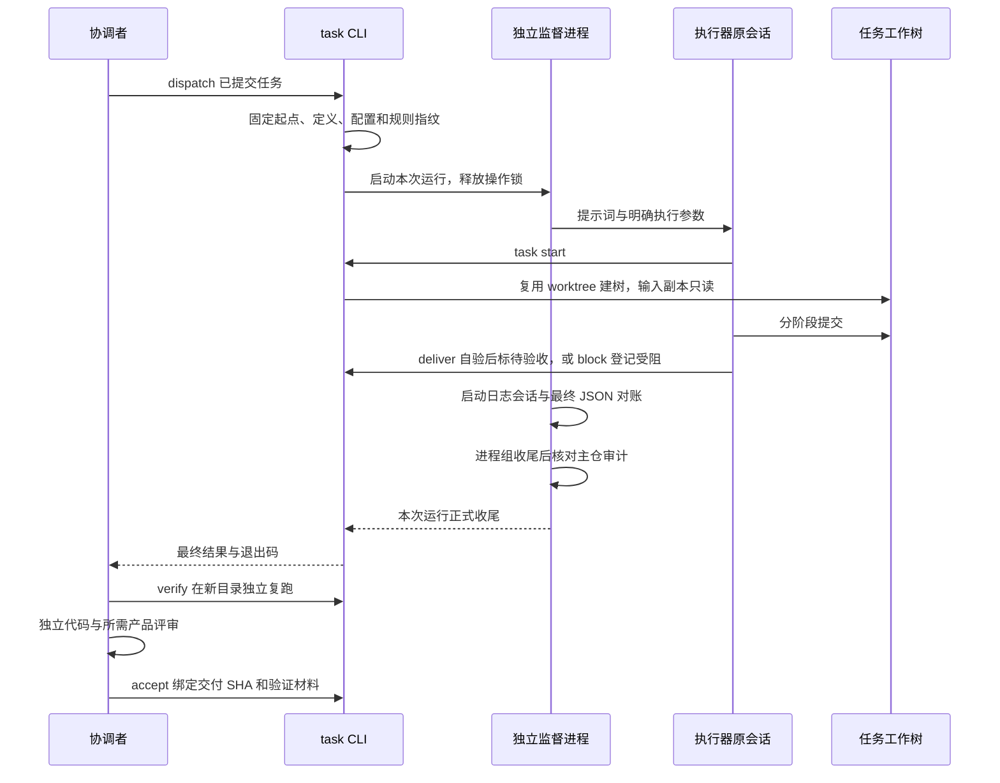

# 任务协作

> 基准：Unreleased（0.9.0 之后）/ 2026-10-25

`nexus-devflow task` 把任务定义、隔离执行和独立验收连成一条链。目标是三条不变量：**执行始终对应已确认的
定义和起点**、**交付能在原执行现场之外复跑**、**验收能追溯到具体提交和证据**。协调者负责定义、返工与验收，
执行者在任务树里完成工作，独立监督进程负责运行收尾。建树复用 [worktree 模块](并行开发与发版.md)，合入和
发布仍由宿主负责。

## 1. 一个任务的一生

以修复「取消购买后仍扣款」的 `cancel-buy` 为例：

1. 协调者提交任务文件，写明目标、输入、可写白名单和复跑命令。`task dispatch` 先执行宿主预检，
   再固定起始提交以及定义、配置、规则的指纹，启动监督进程与执行器。
2. 执行器读取任务，通过 `task start` 在固定起点建任务树，取得经过指纹校验的只读输入副本。
   后续修改与提交都落在这棵树里。
3. 执行者运行 `task deliver`。工具检查交付范围、自验清单与摘要，并在新目录复跑验证命令；
   通过后才提交待验收登记。做不下去时，`task block` 只提交任务文件中的受阻记录，保留现场。
4. 协调者运行 `task verify` 独立复跑，再提供绑定同一交付提交的独立代码审查；涉及产品行为时还要有产品评审。
   `task accept` 核对材料并提交通过登记，分别保存被验证提交和验收登记提交。
5. 需要返工时，`task rework` 把缺陷、复现办法和重新验收标准写入原任务，清空上一轮自验结果；
   `task resume` 恢复原会话和原任务树。通过验收后，协调者按宿主规则集成，归档本地证据后回收工作树。

## 2. 定义、运行和验收为什么分开存

任务 Markdown 保存目标、授权范围、输入、前置依赖、验证命令和人工进度，是任务定义的唯一来源。
机器字段放在唯一的 `task-config` JSON 块里；字段与校验以 `packages/devflow/src/task/definition.ts` 为准。
正文负责解释背景、设计和验收依据，配置负责让工具执行约束。认领、中断、交付与返工记录追加在文件末尾，
因此交付与验收记录是最后一节。

宿主默认值来自 `nexus.config.json` 的 `task` 段，配置校验以 `task/config.ts` 为准。执行器名决定使用哪个
适配器及其启动命令、模型和权限参数；任务可以覆盖执行器与模型，命令行 `--model` 再覆盖本次模型。
`effort` 与 `mode` 只用于 agy。`task.executorEnvDeny` 在启动前剔除指定环境变量，避免执行器继承协调者
不打算传入的授权。派发提示词只携带任务路径、起点、工作树、目标、关键命令和授权边界，公共执行规则由
`task.rules` 指向的文件提供。

本地控制目录保存定义快照、每次运行、原始日志、验证材料和验收记录；它由 Git 忽略，运行不会因此弄脏主仓。
快照把一次执行绑定到固定起点和定义、配置、规则指纹。任一项改变，原快照就不能直接继续执行；
`--refresh-definition` 重新确认并归档旧定义，旧验证材料不能用于新定义。它不替换原任务分支和工作树，
也不负责变基或处理冲突。

运行结果与验收结果分开保存，因为执行器失败不等于交付无效，进程成功也不等于代码通过验收。
`status` 分列任务状态、进程结果、最近复跑和正式验收。最近复跑失败不会覆盖已经登记的正式验收，
正式验收引用的是当时通过的材料及其指纹。工作树回收后，工具只能凭验收登记提交判断是否已集成，
不能声称当前工作副本重新通过了测试。

状态读取按任务隔离：某个定义损坏或任务树切错分支，只让该任务显示错误，不阻断其他任务；单独查询该任务则
非零退出。没有 `task-config` 的任务只显示主仓状态头，标为历史，不能派发；规则文件不作为任务读取。

兼容读取也有边界：当前工具读写 version 2 快照，其他版本不自动改写。只有旧 `task.agy` 段的配置按单执行器
配置读取，存在 `executors` 时优先使用后者。0.7.0 快照按其原配置形状计算兼容指纹，宿主配置未变时可以续跑。
修改版本号或重新确认定义都不能代替格式兼容。

## 3. 固定起点与隔离输入

任务树复用 worktree 的建树与端口登记，但使用独立的 `task.worktreeDir` 和 `task.postCreate`，不继承普通
开发树的共享项和准备命令。路径从主仓定位：配置相对目录时落在该目录的任务标识子目录，配置为 null 时落在
主仓同级的 `<仓库名>-worktrees/<任务标识>`。任务文件声明的路径必须与计算结果一致，不能任意指向仓库外。

输入以校验后的只读副本提供。固定起点已提交的文件随 Git 检出；未提交的输入由 `start` 复制，因此必须被
Git 忽略，否则任务树会一直处于不干净状态。只暂存的文件也属于未提交输入。dispatch 与 start 都拒绝
未提交且未忽略的输入。路径校验解析真实位置，拒绝越界软链；验收输出目录和文件也不能是软链。
只读权限和白名单是协作约束，不构成操作系统沙箱。

固定起点让后续检查回答同一个问题：这次交付相对哪份代码发生了什么。若任务从 A 建树，主仓随后把 A amend
成 B，任务树仍从 A 延续，集成时可能出现 add/add 冲突。dispatch、resume、verify、accept 都检查起点是否为
当前主仓 HEAD 的祖先；脱离时保存 `baseWarning` 并告警，不擅自改起点或否定有效交付。Git 检查失败则报错。
告警对应检查当时的主仓，不是持续更新的历史判断。

基准对齐发生在原任务树：待验收任务先登记返工，再核对两边内容、变基或重放，随后重新确认定义与基准，
重新交付、复跑和审查。重新确认本身不会消除历史分叉。执行器在建树前失败、分支和工作树都不存在时，可以
在主仓用 `dispatch --refresh-definition --model <模型>` 归档旧快照并重派；分支存在而树缺失则拒绝，保留现场
交协调者处理。

前置任务必须有正式验收。前置树还在时，工具核对验收登记提交、未提交内容和隐藏索引标记；树已回收时，
验收登记提交必须进入主仓。前置尚未合入时，下游可通过 `inputs.source` 取得已验收数据的只读副本，但其固定
起点不包含前置代码。需要修改前置代码的下游，必须等前置合入后再派发。依赖中的 commit 指向被验证提交。

## 4. 交付和验收的两道关口

派发前，`task.preflight` 登记的 argv 命令在调用仓库根目录逐条执行，收到 `TASK_ID` 和 `TASK_FILE`。
正式派发先排除正在运行的同名任务，预检通过后才写快照；`--dry-run` 也跑预检，resume 不跑。
预检通过时，预览与正式派发的 JSON 结果都保留每条命令的 stdout/stderr；正式派发无论返回启动结果还是等待最终结果，都能读取需要人工核对的提示。
非零退出或超时会阻断派发并保留命令、退出码与输出尾部。预检超时只终止命令本身，不负责清理其后代进程。

交付关口把机械检查放在执行者离场之前。`deliver` 依次检查：

- **摘要可读取**：普通文件、不是软链、真实路径位于任务树外，且满足大小限制；「改了什么」「验证如何」
  「还有什么」三段都有内容。放在树外是为了避免摘要本身弄脏待交付的工作树。
- **交付可核对**：工作树干净、没有隐藏索引标记、输入指纹一致、提交延续固定起点、改动在白名单内。
  白名单授权新增与修改；删除已有文件还须逐路径列入 `deletable`，重命名同样涉及旧路径的删除授权。
- **清单已自验**：「验收清单」节代码块外的第一张表有「自验结果」列，各项写明「通过：…」或
  「不适用：…」。缺列、空项或未完成项都会阻断交付，后续说明表不参与判定。
- **命令可复跑**：在新的空目录逐条执行登记命令，材料存入独立的 `self-checks` 目录，不覆盖最近独立复跑。
  自验不单独做主仓审计，执行窗口由监督进程审计覆盖。

全部通过后，工具追加摘要、自验材料路径与被自验提交，提交待验收登记并返回新的 HEAD。检查失败则不改变
任务状态、不生成交付提交。`block` 用于保存无法继续的现场，不要求干净或白名单通过，只提交任务文件，
同时记录仍未提交的路径。两条命令都只接受执行中的任务；手工标记待验收的任务仍可被监督进程和 verify 读取。

协调者的 `verify` 复用交付范围检查，但独立创建验证目录并核对主仓审计。命令通过 `{output}` 或
`TASK_VERIFY_OUTPUT` 得到预先创建的空目录，不得依赖固定父目录。每轮保存退出码、stdout/stderr 与产物指纹；
命令改变 HEAD、受跟踪文件或输入也会判失败。指纹不符报告期望值和实际值，文件缺失或新增报告清单变化。

`accept` 再次核对交付 SHA、定义、验证日志、产物和审查记录。它分别保存被验证提交与验收登记提交，避免把
追加验收记录产生的新提交冒充被测试的提交。代码或材料变化后必须重验。工具能核对审查记录字段和提交绑定，
不能核验审查者身份，也不能判断自验文字是否属实；这部分由协调者对照证据判断。

## 5. 主仓审计为什么覆盖整个执行窗口

只检查任务树 diff 会漏掉写向主仓绝对路径的改动；只看主仓是否干净，又会漏掉已经提交的改动。
因此 dispatch/resume 启动前保存主仓 HEAD、分支、索引以及受跟踪文件内容和执行权限的指纹，
执行器进程组收尾后再对比。启动时要求受跟踪文件和暂存区干净，并拒绝 `assume-unchanged`、`skip-worktree`。

执行和复跑采用不同的判定：

| 窗口 | 主仓变化 | 结果 |
|---|---|---|
| 执行期间 | 工作区干净，HEAD 仅快进 | 审计通过，列出新增提交供协调者逐条核对 |
| 执行期间 | 未提交或暂存改动、隐藏索引标记、切分支、改写原 HEAD 历史 | 异常审计，进程结果为 failed，任务树交付保留 |
| 独立复跑期间 | 包括新提交在内的主仓变化 | 异常审计 |

执行可能持续数小时，允许快进是为了让协调者同时集成其他已验收任务；复跑窗口短且由协调者控制，所以要求
主仓静止。快进提醒保存在运行记录中，经等待命令、status 和 accept 展示。工具无法识别提交者是否为协调者，
执行者直接向主仓提交也可能只触发快进提醒，必须人工核对提交内容。

审计文件保存在 `main-audit`，每次执行在 `main-audit-refs` 单独登记引用，删除证据会导致核对失败。
verify 在复跑前检查主仓与已有异常，每条命令执行前后也检查；命令失败和后代进程收尾仍须审计。
accept 核对主仓当前状态以及验证材料绑定的审计和人工核对记录。审计保存路径、Git 状态和指纹，不复制正文。

恢复干净、补提交或重新派发都不会把旧异常改成通过。协调者核对现场后，通过 `verify --main-review` 提供
仓库内的 JSON 核对记录，其中包含核对人、理由和异常审计的 id、sha256。工具确认所有异常引用后另存记录，
再完整复跑；原审计仍为失败。同一核对记录可复用，不能用新理由覆盖，也不能绕过当前脏状态或代替代码审查。

审计只证明窗口内观察到的变化，不能证明谁写入，也不阻止写入。写后恢复到相同状态的操作可能不被发现；
未跟踪文件、兄弟树和子模块内部工作副本不在检查范围内。读取全部受跟踪内容的成本随仓库体积增加。
未正常收尾的审计保持未通过，旧运行缺失的审计不会被补造。

## 6. 监督进程、等待与中断

dispatch/resume 启动独立监督进程后释放操作锁，默认等待本次运行正式收尾；`--detach` 只启动。
等待绑定本次运行，不占操作锁，也不随 latest 索引切换。同任务的重复派发、续跑或验收被拒绝，不同任务可以
并行运行。操作锁记录持锁进程号；进程已经退出时，下次操作回收残锁并报告，没有进程号的旧锁留给人工确认。

监督进程与执行器各自写日志，都不继承调用方输出管道，所以调用方停止等待不影响执行器。
INT/TERM 只取消当前等待；真正的终止由监督进程按显式硬期限管理。首轮预算只是进度检查节点，不杀任务，
进度采样也不会根据 idle 日志自动催促。时间参数受 Node 定时器范围约束，超出范围在配置或定义校验时拒绝，
避免溢出后立即触发期限。

终止时先清理执行器进程组、确认后代退出，再向任务树提交中断记录，防止仍在收尾的子进程与记录提交抢写。
后代未能退出时不写中断提交，由运行记录的 `recordError` 说明原因。监督进程失去正常收尾时，status 和等待
命令把该轮报告为中断，避免永久显示运行中。

`task watch` 轮询运行记录，全部结束时返回摘要和退出码 0，期限内仍未结束则退出 3 并保留现场。
取消观察只退出观察器，不终止任务；监督进程已退出但记录仍为运行中时，按中断处理。观察器提供当前调用的
等待结果，不保证宿主在会话结束后继续保留进程或自动唤醒会话，task 也不向其他会话发消息。

并发通过多个独立等待进程及各自的输出文件，或分别 `--detach` 后观察实现。默认阻塞派发放进串行循环会
逐个等待。执行器共享账号额度，task 没有全局并发上限，也不自动重试 429；增加任务预算不会延长执行器自身
等待单条命令的上限。宿主需要据此控制并发，并为长流程保留可恢复的阶段检查点。

## 7. 执行器适配与原会话续跑

适配器负责拼装启动命令、在运行中识别本次会话、结束后读取结果，并尽可能从失败输出中恢复会话标识。
agy 从增量日志中的创建或恢复会话记录认出 ID，最终 JSON 要报告 SUCCESS 并与登记会话一致；opencode
从完整的 JSON 行事件识别会话与最终回复。半行、其他会话和未知格式不能当成本次会话证据。
无法识别日志格式时，工具从最终输出登记并报告回退。

`resume` 使用原会话标识和原工作树，显式 `--conversation` 优先，但日志和最终输出仍须与它一致。
原树缺失或会话不明就报错，不暗开新会话。待验收任务先通过 `rework` 登记缺陷、复现命令和重新验收标准，
才能续跑；返工要求原树干净且没有活动执行进程，只提交任务文件，不自动启动执行器。

运行结束分类单独写入 `endReason`，区分交付、受阻、中断、失败和停在计划确认。
停等分类只在退出码为 0、既未交付也未受阻、最终回复包含请求确认计划的措辞时成立，供协调者诊断，
不改变真实退出码，也不授予权限。分类追加到 `notify.log` 供外部监视读取；写入失败记入 `notificationError`，
不改变本次运行收尾。

opencode 非零退出且未被信号终止时，适配器提取最后一条报错，清理控制字符、限长后附到运行错误中。
这是诊断线索，不保证是根因；agy 适配器不提取该类报错。退出码为 0 的失败保留原失败描述，避免干扰停等分类。

CLI 默认 stdout 输出 JSON，stderr 输出带 `[task]` 前缀的错误；help 与 `status --short` 输出可读文本。
交付退出 0，受阻退出 3，失败退出 1，取消等待返回 130/143。进程结果只说明这轮执行如何结束，
最终是否可集成仍由独立复跑、审查与正式验收决定。

## 8. 实现来源与验证边界

任务机制取材于 旧项目C 的任务工具与实际任务记录。公共实现只负责协作管线，研究模型、ROM、Python
环境及具体研究命令由宿主提供。宿主应遵守的配置、证据保留与集成义务见[接入规范](../规范/接入规范.md)。

`pnpm test:task` 通过真实临时 Git 仓库、devflow 工作树和可控外部执行器，调用构建后的公开 CLI 验证管线，
c8 统计子进程覆盖率。它能验证任务管线，不能证明真实执行器兼容；真实 agy 和真实宿主接入需要各自的运行证据。
原始材料保存在本地控制目录，不随 Git 克隆提供。
