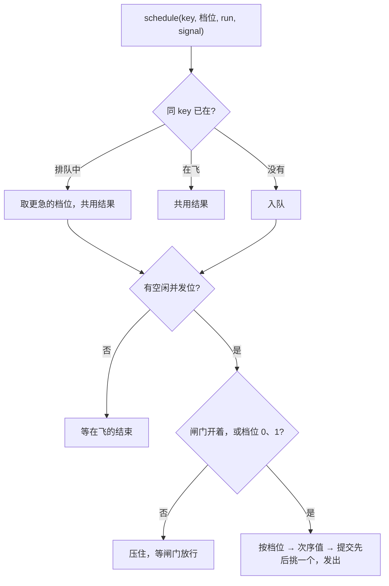

# 图像资源

> 基准： 0.7.0 / 2026-10-15

`@nexus-kit/runtime/assets` 回答两个问题：**慢网下先下哪张、后下哪张**（加载调度器），**解码后的图放多久**
（图像缓存）。需求证据取材旧项目A的加载实现与真机实测结论。

## 1. 一个相册页走一遍

宿主建一个调度器和一个缓存：`createLoader({ log, perf })`、`createImageCache({ loader, budgetMB: 64, perf, onEvict })`。

1. 相册页进来，首屏 12 张缩略图以档位 1 调 `cache.acquire(url, { tier: 1 })`，再把这 12 个 Promise 合起来交给
   `loader.hold(全部首屏图, 5000)`，挂上关键闸门。
2. 下面 200 张以档位 3 acquire。闸门关着，它们全部排队，一个请求都不发；首屏 12 张按并发上限（默认 6 路）
   分两轮下完。
3. 首屏 12 张都有了结论（成功或失败都算），闸门放行，日志记一条「关键闸门放行」，带放行原因和当时压住的
   任务数。档位 3 的图开始按提交先后发出。
4. 用户快速滚到底部。宿主把底部几张 `reprioritize` 到档位 1，它们插到队首；已经在飞的请求不打断。滚过去还在
   排队的图，宿主用 AbortSignal 取消，它们出队、不再发请求。
5. 离开相册页时，宿主对每张已拿到的图调 `release`。引用为零的图进 LRU；再回来时 acquire 命中缓存，不重新
   下载、不重新解码。预算不够时，最久没用的图被 `close()`，宿主在 `onEvict` 里销毁基于它建的纹理。

## 2. 加载调度器

调度器只管「什么时候发请求」，请求本身由宿主的 `run` 函数发。

**排序。** 每个任务带档位（0 挡门 / 1 可见 / 2 附近 / 3 空闲）和可选的次序值（例如与视口中心的距离）。
空出一个并发位时，调度器从排队任务里挑档位最小的，同档挑次序值最小的，再同就挑先提交的。只给还没发出的
任务排序，在飞的请求不会被后来的高档任务打断——打断会白白浪费已经下载的字节，在慢网上这些字节最贵。
并发上限默认 6：旧项目A 在高延迟真机（每请求约 1 秒）上实测用这个值，也是 HTTP/1.1 每域连接数的惯例。
上限不取无穷，因为请求太多会和 Service Worker 预缓存抢链路，移动端解码也吃 CPU。

**同一份资源只下一次。** 任务按 key 去重，key 通常就是 URL。同一个 key 还在排队或在飞时，后来的调用直接拿到
同一个结果，它自己传的 `run` 不会执行；还在排队时，档位取两次里更急的那个。旧项目A 曾经因为「预热」和
「正式取用」用了不同的 key，同一页图集同时下了两次，只好另做一张在途预热登记表。kit 统一用 URL 当 key，
这个问题在调度器里就没有了。

**取消。** 每次调用可以带 AbortSignal。一个调用方取消，只拒绝它自己那份 Promise。所有调用方都取消、
而且任务还在排队时，任务才出队，请求不发。任务已经在飞时，取消的调用方拿到 AbortError，请求照常跑完。

**关键闸门。** 浏览器的 fetch priority 提示在 Safari 上无效，应用层唯一可靠的办法是「低优先级的先别发」。
旧项目A 的证据：慢网下开门后同时在飞 39 个请求，玩家第一眼要看的怪 60 秒没出来。`hold(关键Promise, 封顶毫秒)`
在关键 Promise 有结论之前压住档位 2、3 的任务，档位 0、1 照常发。封顶时间一到也放行，不急的任务不会饿死。
关键 Promise 先有结论时，封顶定时器随即撤掉，不留一个空等的定时器。
新的 `hold` 取代旧闸门：旧闸门下还在排队的低档任务改为等新闸门放行，旧闸门到期不会打开新闸门。所以宿主离开
一屏时，应该取消上一屏不再需要的任务。另外，宿主两次 `hold` 的间隔如果总比封顶时间短，低档任务会一直
发不出去。

## 3. 图像缓存

解码位图从解码那一刻起就占进程内存，体积是宽 × 高 × 4，和这张图有没有画到屏幕上无关。只把引用置空，
位图要等垃圾回收才释放；换页时新旧两份同时活着，峰值远高于实际需要。旧项目A 在 iOS 上大图换大图白屏，
就是这笔内存没进任何一本账。

缓存的做法是按引用计数持有：

- `acquire(url, 档位, { signal })` 经调度器下载（`fetch`），检查 HTTP 状态，再解码成 ImageBitmap
  （`createImageBitmap`），引用加一。同一张图同时取两次，只下载、解码一次。成功的 acquire 才占引用；
  下载失败、解码失败、被取消的都不占，调用方也不用 release。传进来的信号已经取消时，即使缓存里有这张图也直接
  拒绝，不占引用。HTTP 状态不是 2xx 时先取消响应体再报错，否则连接要等垃圾回收才放回，白占一个并发位。
- `release(url)` 引用减一。减到零，图进 LRU（最久没用的排在前面）。多释放一次只记一条 warn，不抛错。
- 总解码字节超过预算时，从 LRU 最前面开始淘汰：立即 `close()` 位图、扣账、调宿主的 `onEvict(url)`。
  还在被引用的图不淘汰，全部都在用时超预算就照实记账——预算管的是「不用了还留着」的那部分。
- 失败的图不进缓存，下次 acquire 重新下载。
- 所有调用方都取消了、请求却已经在飞：下完照样解码进缓存，引用为零，直接进 LRU，可以被淘汰。解码刚完成、
  调用方恰好在拿到结果之前取消，也走同一条路：引用归零的图一律进 LRU，不会留在缓存里永远淘汰不掉。

统计（`stats()`）记张数、被引用的张数、解码字节、本局峰值、命中、未命中和淘汰次数。峰值按解码完成那一刻算：
新图解码完、旧图还没被淘汰时，两份同时在内存里，峰值如实包含这一刻。`dispose()` 关掉全部位图（包括还在
被引用的），之后才下完的图解码完立即关掉；dispose 之后 acquire 直接拒绝，宿主收尾时的 release 静默忽略。

## 4. 进水位长线

调度器和缓存都可以传 `perf`（`/perf` 的 `createPerf` 返回值，只用到它的 `registerGauge`）。传了之后，每个水位点
多四个指标：`assets.bitmapMB`（解码字节）、`assets.bitmaps`（张数）、`assets.queued`（排队任务数）、
`assets.running`（在飞任务数）。看泄漏时盯 `assets.bitmapMB` 的走势：每次离开一页都回落才正常，一路涨不回落
就是有图没 release。`dispose()` 注销这些指标。同一个 perf 上建两个缓存时，后建的指标会顶掉先建的。

## 5. 两个配套工具

`mapLimit(列表, 并发数, fn)` 限并发批量执行，结果严格按输入顺序返回，任一项失败整体拒绝，
之后不再取新项（失败那一刻已经在跑的项会跑完）；并发数不是正整数直接抛错。它解决的是串行加载：
串行在高延迟链路上等于「请求数 × 单次延迟」，旧项目A 真机上 34 页图集串行吃掉 34.7 秒。

`whenIdle(fn)` 把首屏期间不急的工作推到空闲时执行，返回取消函数。有 `requestIdleCallback` 时用它，带 3 秒封顶；
iOS 16.4 以前没有它，退到 1.5 秒后的定时器。

## 6. 不管的事

kit 只管自己下载、解码的位图。渲染库（Pixi、Three）自己调 `createImageBitmap` 解出来的位图不在这本账里；
渲染库的纹理缓存怎么清（例如 Pixi 的缓存键）也归宿主，宿主经 `onEvict` 接上。图片以外的资源（JSON、音频文件）
可以直接用调度器排队，缓存只管图像。

## 7. 验证

单测注入定时器、fetch 和解码函数（`packages/runtime/src/assets/*.test.ts`），覆盖排序与重排、去重并升档、
三种取消、闸门的两种放行与新旧闸门替换、LRU 淘汰与 close、被引用不淘汰、失败不进缓存、在飞时取消。

真浏览器 e2e（`scripts/e2e-assets.ts`，在 `pnpm e2e` 里）用一个只引用 runtime 构建产物的测试页。图片请求由
Playwright 拦下，现做 PNG，每个请求压 800ms 延迟。断言五件事：
- 档位 2、3 的请求都在关键图有结论之后才发出；
- 同时在飞的请求不超过并发上限；
- 同一张图同时取两次只请求一次；
- 超预算淘汰的位图宽高变成 0（已关闭）；
- 水位点和 JSONL 里有这四个指标。

去掉 `hold` 再跑，闸门的两条断言都会变红，说明它们确实能抓到闸门失效。
