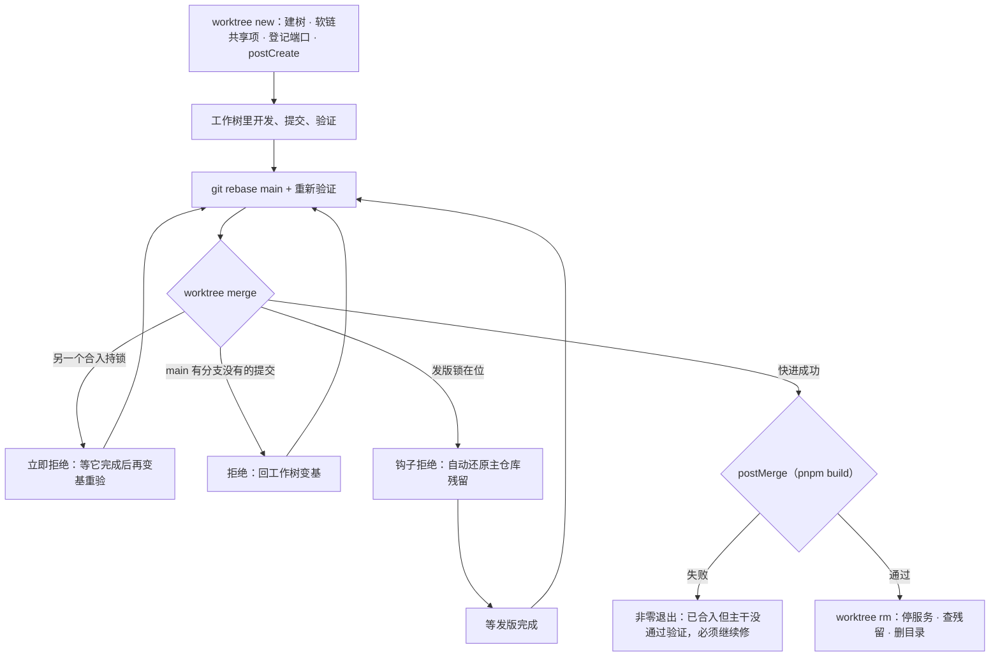
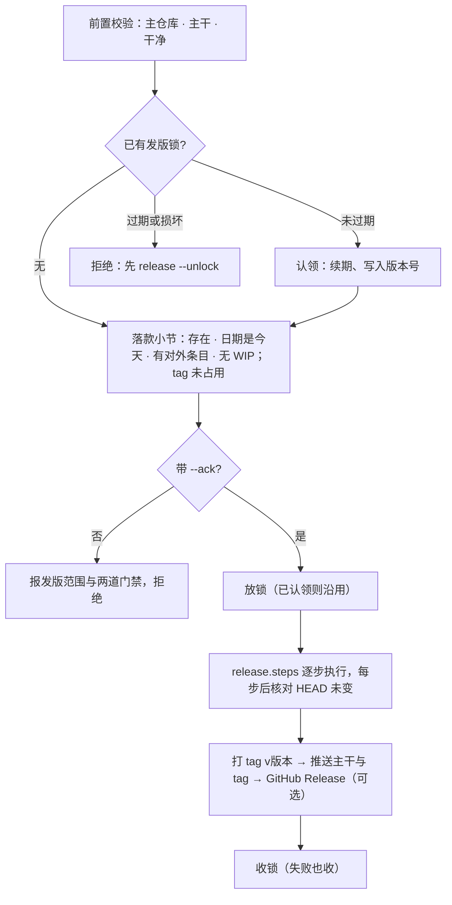

# 并行开发与发版

> 基准： 0.3.0 / 2026-10-14

`nexus-devflow worktree` 与 `nexus-devflow release` 让多条改动线（多个终端、多个 Claude 会话、子 Agent）
同时在一个仓库里干活而不互相踩脚。目标是三条不变量：**主干上的每个提交都是验证过的代码**、**并行线
互不覆盖对方的文件和端口**、**发版期间主干不被不知情的合入改动**。实现取材 旧项目A 的
`scripts/worktree.mjs` 与 `scripts/release.mjs`，项目差异全部收进 `nexus.config.json` 的 `worktree` 与
`release` 两段（字段与默认值以 `packages/devflow/src/config.ts` 为准）。

## 1. 一条改动线的一生

拿模板生成的项目 `my-app` 走一遍。主仓库在 `~/ws/my-app`，检出 main。

1. `pnpm worktree:new feat/login` 在 `~/ws/my-app-worktrees/login` 建工作树，自 main 新建分支
   `feat/login`。`worktree.share` 列出的路径（模板里只有 `.build-number`）不入 git，新工作树天然没有，
   脚本把它们软链回主仓库：两棵树里 `pnpm build` 递增的是同一个构建号。脚本给这棵树分一个预览端口
   （主仓库占 4173，工作树从 4183 起每次加 10，跳过已登记和正在监听的端口），写进
   `.git/worktrees/login/nexus-port`，最后在新树里跑 `worktree.postCreate`（默认装依赖）。
2. 在工作树里开发、提交、`pnpm check`。预览服务用 `--port 4183 --strictPort`。
3. 同时另一条线 `feat/pay` 先合进了 main。`feat/login` 做完后在工作树 `git rebase main`，在变基后的代码上
   重新验证。
4. `pnpm worktree:merge feat/login`。脚本先抢主仓库的合入锁，确认主仓库检出 main 且干净，然后只做快进：
   main 是 `feat/login` 的祖先就前移 main，不造合并节点。合入后在主仓库跑 `worktree.postMerge`（默认
   `pnpm build`）。
5. `pnpm worktree:rm login`：停掉工作目录在这棵树里的监听进程和 pm2 应用，确认没有回收后找不回来的文件，
   删目录。分支保留。

## 2. 为什么合入只快进

合入前分支已经变基到最新 main 并验证过，快进让 main 指向的正好是验证过的那个提交。如果在主仓库做真合并，
合出来的组合代码没人跑过测试，有冲突还会留在主仓库里卡住其他线。所以 main 有分支没有的提交（分叉）时
脚本直接拒绝，让人回工作树变基，主仓库不做任何改动。

合入锁是 `<git 公共目录>/nexus-merge.lock` 目录，里面写持锁进程的 pid 和分支名。另一个合入正在进行时
立即拒绝，不排队：排到的时候 main 已经前移，快进资格早没了，排队只是白等。持锁进程已死、或锁存在超过
20 分钟，视为残锁：先把锁目录改名到唯一名字，再核对搬走的正是判定时看到的那把（目录 mtime 与 pid 都相同）
才删；判定之后别人已清掉旧锁、建了新锁的话，搬走的是别人的新锁，原样放回。释放锁时只删 pid 是本进程的锁。

postMerge 失败不回滚合入：main 可能已被别的线接着推进，失败也多是产物或环境问题。脚本非零退出并写明
「已合入但没通过合入后验证」，修复照样走工作树合回。

## 3. 共享项与隔离

`worktree.share` 解决「不入 git 的东西新树里没有」。软链是双向的：在工作树里重新生成一个共享目录，会顺着
软链写进主仓库，污染其他线。需要本树独立一份时，在工作树里 `pnpm worktree:isolate <共享项>`：先把主仓库
现有内容复制到临时目录，再用它替换软链（`--empty` 留空目录）；任一项复制失败时所有软链原样不动。建树时
`--isolate=<共享项>` 直接留空目录。隔离出的目录是真文件，里面可能有本树生成或手写的内容，回收时照样拦下；
确属可再生的（例如由转换器生成的产物目录），宿主把它登记进 `worktree.disposable`。共享项必须是不入 git 的路径：被跟踪的同名文件会被检出到新树里，脚本
遇到这种情况报错回滚，不覆盖。

## 4. 回收判定

`git worktree remove` 只拦未提交改动，不拦被忽略文件，也不管树里起的服务。`worktree rm` 先读
`git status --porcelain --ignored`，把每一行分成两类：

- **可再生，随树删**：`node_modules/`；仓库根或 `apps/*`、`packages/*` 包根下的 `dist`、`build`、`coverage`、
  `.cache` 等生成目录；`*.log`、`*.tsbuildinfo`、`.DS_Store`；`.codegraph/` 索引；`worktree.disposable` 列出的
  路径；任何软链本身（删链不删目标，所以建树挂的共享软链随树删）。
- **回收会丢，拦下**：其余一切，包括未提交改动、未跟踪文件、`temp/`、`.env`、深层的同名手工目录。

有拦下项就拒绝回收，列出路径；确认都不要了加 `--force`。通过后先删 pm2 应用（否则杀掉的进程会被拉起），
再停工作目录落在树内的监听进程（SIGTERM，3 秒不退 SIGKILL；跳过本进程的祖先链，回收钩子可能就跑在这棵树
的会话里），最后删目录。进程探测依赖 `lsof` 与 `ps`，只支持 macOS 和 Linux。

## 5. Claude Code 接入

模板的 `.claude/settings.json` 把 `WorktreeCreate` / `WorktreeRemove` 钩子接到 `nexus-devflow worktree
hook-create` / `hook-remove`，`claude --worktree` 和子 Agent 的 `isolation: "worktree"` 因此走同一套建树逻辑：
分支名 `worktree-<名>`，起点取发起会话当前的 HEAD（子 Agent 通常要在进行中的分支上接着干），同名再开时复用
既有工作树。钩子模式下 stdout 只输出工作树路径，其余日志和子命令输出一律走 stderr。回收钩子额外删除已经
全部合入主干的 `worktree-*` 分支。主仓库建过 CodeGraph 索引（有 `.codegraph/`）时，新树里跑一次
`codegraph init -y` 重建本树索引，失败不阻断建树。

## 6. 发版链与发版锁

`nexus-devflow release` 把落款之后的发布动作收成一条命令：

发版锁是 `<git 公共目录>/nexus-release.lock`，JSON 记版本、令牌、被冻结的引用（`refs/heads/<主干>`）、失效
时刻。`install-hooks` 把 `core.hooksPath` 指到 `.githooks` 并写入 `reference-transaction` 钩子。这是相对路径，
git 在每个工作树里按该树的根目录找钩子，所以 `.githooks/` 必须入库（`init-app` 生成项目时就写好，随首个提交
入库；建树时发现新树里没有钩子目录会警告）。钩子在每次引用变更的 prepared 阶段读它：锁在、未过期、
这次变更要改被冻结的引用、环境变量 `NEXUS_RELEASE_TOKEN` 与锁内令牌不符，就拒绝。锁挂在
reference-transaction 而不是 pre-merge-commit，是因为快进合并不触发 pre-merge-commit（旧项目A 在 git 2.54
实测），而一切引用变更都经过 reference-transaction。锁读不到或解析不出一律放行。

锁有两种来源。`release --lock` 在落款前手动放锁并打印令牌，发版执行人在自己的会话导出令牌，落款和评审
修复的合入凭令通过，其余会话对主干的更新一律被拒，直到 `release --ack` 认领这把锁跑完全链。没有手动放锁时，
`release --ack` 在链内自己放锁。链上每一步开始前把失效时刻续到「现在 + `lockTtlMin`」，整条链比有效期长时
主干也不会中途解冻；单步内不续期，所以 `lockTtlMin` 必须大于最慢那一步（通常是部署）的耗时；续期前核对锁里的令牌还是本链的，锁被人清除或换成别人的就中止。续期先写临时文件再改名，
钩子任何时刻读到的都是完整内容。链末在 finally 里收锁，只收令牌一致的那把；进程被强杀留下的残锁到失效时刻
自动放行，`release --unlock` 可手动清。

这把锁防的是不知情的并发合入，不防存心绕过：`git -c core.hooksPath= ...` 可以整体跳过钩子，同机进程也能
读到令牌。合入脚本被锁拦下时，git 已经改了主仓库的工作区和暂存区而引用没动，脚本用
`git read-tree --reset -u HEAD` 把残留还原（不改引用，钩子不拦；未跟踪文件不碰）。

## 变更记录

- 2026-10-14 建篇：worktree 与 release 从 旧项目A 抽入 devflow（0.3.0）。
