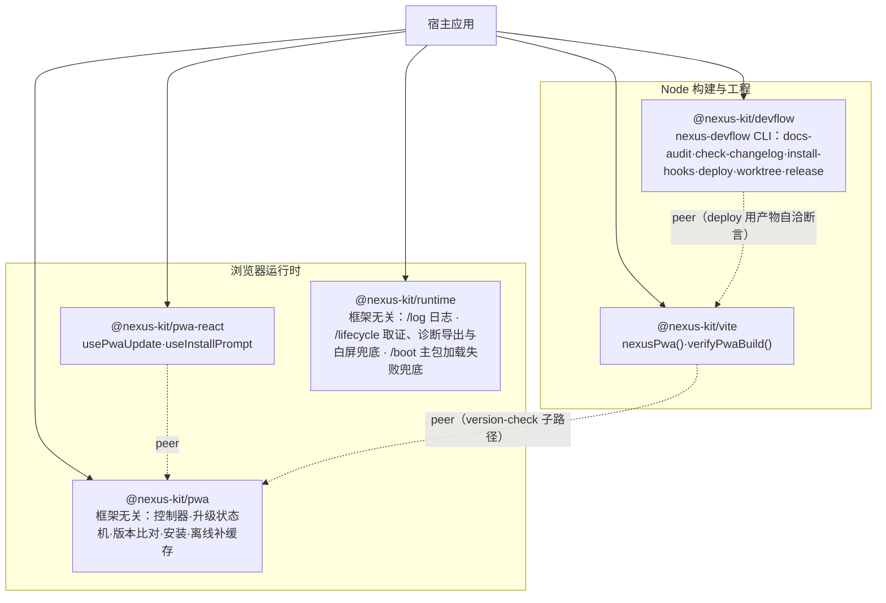
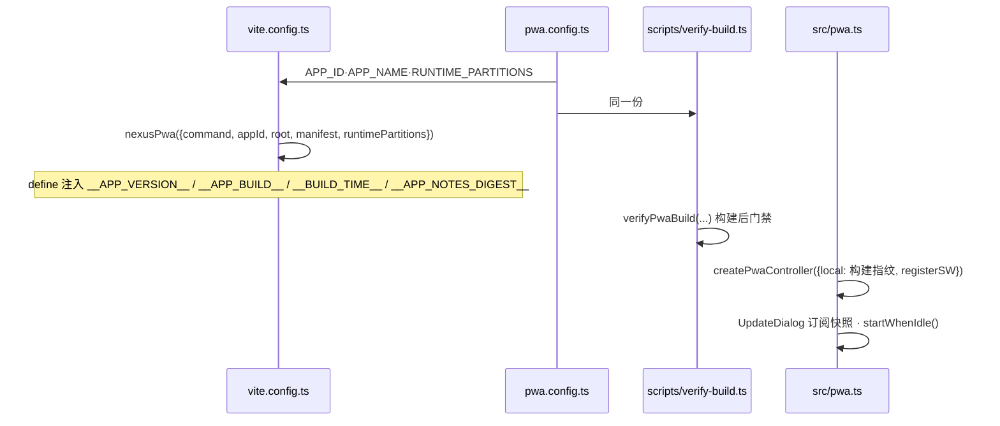

# 架构总览

> 基准： 0.4.0 / 2026-10-14

## 1. 包与边界

- **pwa 零框架依赖**：DOM 与 SW 全部在函数体内访问，Node 里 import 不报错；`virtual:pwa-register`
  只在宿主的 vite 构建里可解析，由宿主 import 后注入控制器。
- **runtime 按子路径分模块**：`/log`、`/lifecycle`、`/boot`（后续期加 `/perf`、`/assets`、`/audio`），与 pwa 同样
  零框架依赖；宿主只 import 用到的子路径。宿主把 `log("pwa")` 作为 pwa 控制器的 logger 传入，两个包之间
  不互相依赖。机制见[日志与诊断](日志与诊断.md)。
- **pwa-react 不写样式**：只出 hook，弹窗长什么样归宿主。
- **vite 只在构建期跑**：读宿主的 package.json、CHANGELOG、public/，写 define、version.json、清理
  脚本，配好 VitePWA。指纹函数与运行时共用 `@nexus-kit/pwa/version-check` 同一份实现。
- **devflow 读 `nexus.config.json`**：宿主仓库根一份配置，文档审计、提交门禁、部署、工作树、发版共用；
  外部配置在边界校验，写错即报哪一项。工作树与发版的机制见[并行开发与发版](并行开发与发版.md)。

## 2. 宿主接线

`pwa.config.ts` 是 PWA 配置唯一出处：构建与构建后门禁读同一份，分区声明不可能两边分歧。

## 3. 分发与版本

- 私有仓库 `iazrael/nexus-kit`，消费方用 git 子目录依赖钉 tag：
  `git+https://github.com/iazrael/nexus-kit.git#v<版本>&path:/packages/<包>`。
- `packages/*/dist` 入库：git 依赖不跑构建，装上即用。`pnpm check` 在构建后检查 dist 与提交一致。
- 包之间只用 peerDependencies（git 依赖不认 `workspace:` 协议）；kit 内开发用 devDependencies 的
  `workspace:*` 解析到本地。
- `packages/` 下全部包同版本号，同一个 tag 发布；版本规则见[工程质量与交付规范](../规范/工程质量与交付规范.md)。

## 4. 模板

`templates/webapp` 同时是 kit 内的 playground（依赖走 `workspace:*`）和新项目的起点
（`pnpm init-app` 拷贝时改写为钉 tag 的 git 依赖）。它是升级链 e2e 的被测应用，也是
「kit 改动没有破坏接入方」的第一道验证。

## 变更记录

- 2026-10-13 建篇。
