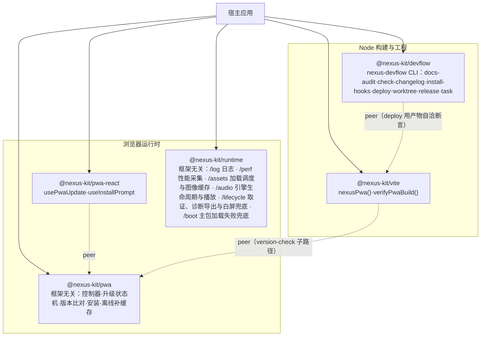
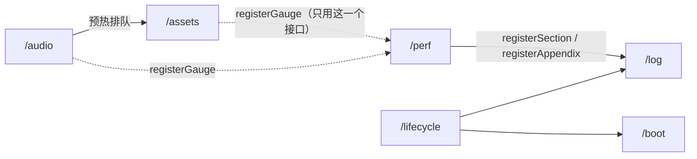
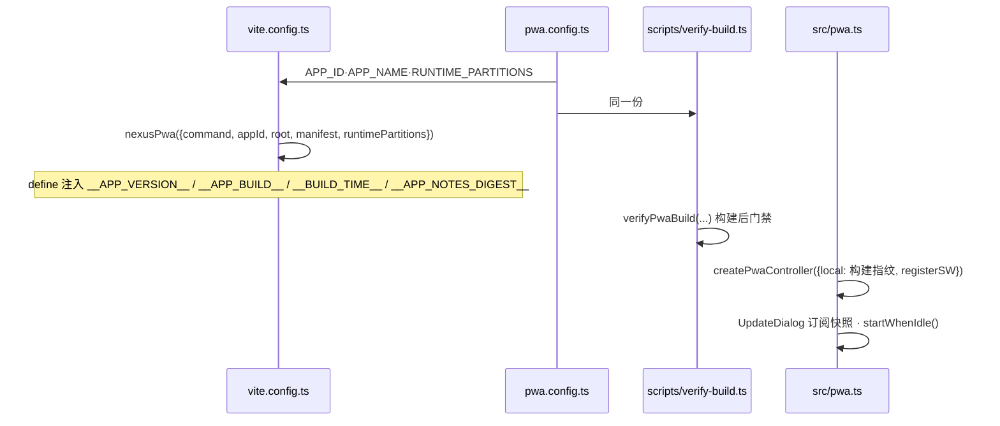

# 架构总览

> 基准：0.8.0 / 2026-10-20

## 1. 包与边界

- **pwa 零框架依赖**：DOM 与 SW 全部在函数体内访问，Node 里 import 不报错；`virtual:pwa-register`
  只在宿主的 vite 构建里可解析，由宿主 import 后注入控制器。
- **runtime 一个包、按子路径分模块**：`/log`、`/perf`、`/assets`、`/audio`、`/lifecycle`、`/boot`，与 pwa 同样
  零框架依赖，DOM、Web Audio、Performance API 只在函数体内访问；宿主只 import 用到的子路径，没用到的不进 bundle。
  做成一个包而不是五个，是因为模块之间有真实依赖（下图），拆开就要多组 peerDependencies 和同步发版。宿主把
  `log("pwa")` 作为 pwa 控制器的 logger 传入，runtime 与 pwa 两个包互不依赖。

  虚线与 `/perf`、`/log` 之间的箭头都是「调用宿主传进来的实例」，这些子路径之间只 import 类型。唯一直接 import
  实现的是 `/lifecycle` → `/boot`：白屏兜底页的「重新加载到最新版」直接用 `/boot` 的 `reloadLatest`，与注入
  `index.html` 的内联兜底是同一份源码。机制见[日志与诊断](日志与诊断.md)、[性能采集](性能采集.md)、
  [图像资源](图像资源.md)、[音频](音频.md)。
- **pwa-react 不写样式**：只出 hook，弹窗长什么样归宿主。
- **vite 只在构建期跑**：读宿主的 package.json、CHANGELOG、public/，写 define、version.json、清理
  脚本，配好 VitePWA。指纹函数与运行时共用 `@nexus-kit/pwa/version-check` 同一份实现。
- **devflow 读 `nexus.config.json`**：宿主仓库根一份配置，文档审计、提交门禁、部署、工作树、发版共用；
  外部配置在边界校验，写错即报哪一项。工作树与发版的机制见[并行开发与发版](并行开发与发版.md)，任务管线、执行器、监督进程与验收对账见[任务协作](任务协作.md)。task 配置为可选段，任务隔离配置不改变普通 worktree 配置；agy 适配只负责执行参数与会话结果。

## 2. 宿主接线

`pwa.config.ts` 是 PWA 配置唯一出处：构建与构建后门禁读同一份，分区声明不可能两边分歧。

runtime 的接线在三处。`vite.config.ts` 用 `bootGuardScript` 往 `index.html` 注入主包加载失败兜底的内联脚本。
`src/observe.ts` 是 `main.tsx` 的第一个导入：先 `markBooted()` 让内联兜底退出，再依次建日志 store、启动取证、
创建并启动性能采集、挂未捕获异常、装白屏兜底，并导出诊断面板入口。`main.tsx` 在根组件外包错误边界，渲染崩溃
交给白屏兜底，挂载成功时调 `onAppMounted`（撤下兜底、记时间点、采启动画像）。图像资源与音频由用到的宿主自己建，
接入义务见[接入规范](../规范/接入规范.md) §8、§9。

## 3. 分发与版本

kit 有两条分发渠道。命令行工具（worktree、task、release、install-hooks）走 PATH：`pnpm install-cli` 把
`~/.local/bin/nexus-devflow` 软链到 kit 主仓库的 `packages/devflow/dist/cli.js`，kit 主干合入并重建 dist 后，
所有走 PATH 的存量项目立即用上新代码，撤回也是在主干 revert 再重建 dist。软链总是指向主仓库而不是工作树，
否则工作树回收后软链悬空。库包（pwa、pwa-react、runtime、vite）要参与应用构建，按下面的规则钉 tag；模板生成的
项目对 devflow 也钉 tag。这样取舍的实测依据见[命令行工具统一接入](../存档/命令行工具统一接入_2026-10-20.md)「安装方式的取舍」。

- 私有仓库 `iazrael/nexus-kit`，消费方用 git 子目录依赖钉 tag：
  `git+https://github.com/iazrael/nexus-kit.git#v<版本>&path:/packages/<包>`。
- `packages/*/dist` 入库：git 依赖不跑构建，装上即用。`pnpm check` 在构建后检查 dist 与提交一致。
- 包之间只用 peerDependencies（git 依赖不认 `workspace:` 协议）；kit 内开发用 devDependencies 的
  `workspace:*` 解析到本地。
- `packages/` 下全部包同版本号，同一个 tag 发布；版本规则见[工程质量与交付规范](../规范/工程质量与交付规范.md)。

## 4. 模板

`templates/webapp` 同时是 kit 内的 playground（依赖走 `workspace:*`）和新项目的起点
（`pnpm init-app` 拷贝时改写为钉 tag 的 git 依赖）。它是升级链与日志诊断两条 e2e 的被测应用，也是
「kit 改动没有破坏接入方」的第一道验证。模板没有图片和声音，图像资源与音频的 e2e 用只引用 runtime 构建产物的
独立测试页（`scripts/e2e-assets.ts`、`scripts/e2e-audio.ts`）。
