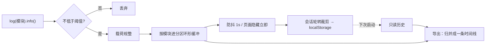
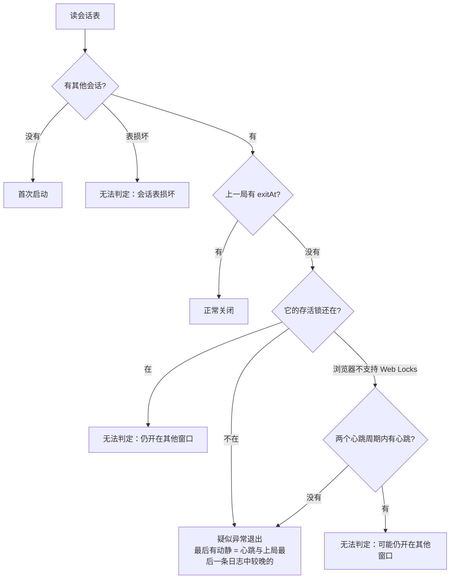

# 日志与诊断

> 基准： 0.4.0 / 2026-10-14

`@nexus-kit/runtime` 的 `/log` 与 `/lifecycle` 两个子路径回答一个问题：用户说「刚才出问题了」「刚才闪退了」，
开发者拿到一个文件，能不能按时间还原现场。目标是三条不变量：**低频的关键事件不会被高频事件挤掉**、
**刷新、升级、崩溃之后上一局的记录还在**、**导出的文件里写明上一局是怎么结束的**。需求证据与分期见
设计稿[运行时基础设施](../设计/运行时基础设施.md)。

## 1. 一条日志的一生

模板里 pwa 控制器检测到新版本，调用 `logs.log("pwa").info("检测到新版本，开确认窗", { reason })`：

1. 当前阈值是 info，这条不低于阈值，往下走；如果是 debug，到这里就丢掉，既不入缓冲也不打印。
2. 载荷规整成纯 JSON 副本：数字、布尔、字符串直接放行；`Error` 展开成名称、消息与截断到 1000 字符的堆栈
   （默认序列化会把它变成 `{}`），BigInt 转字符串；带循环引用的换成「无法序列化」说明文字，超过 2000 字符
   的截断并注明原长。所以后面的持久化和导出不会因为这条记录失败。序列化发生在截断之前，别把大对象整个传进来。
3. 记录补上时刻（墙钟，但单调不减：系统校时回拨也不打乱时间线）和会话号，按模块名找到分区推进环形缓冲。宿主没声明分区时只有一个默认区（2000 条）；
   声明了的话，例如把 `combat` 单独放进 3000 条的高频区，命中结算再多也只淘汰高频区自己最旧的记录。
4. 打印到 console，并标记待落盘。1 秒内的多条记录合并成一次写入；页面隐藏或 `pagehide` 时立即写。
5. 写入前裁剪：只留最近 3 个会话（含本次）；序列化后超过 40 万字符就整段淘汰最旧的会话，只剩本次仍超才从
   本次最旧的条目开始丢。这就是浏览器里的日志轮转——轮转单位是会话。
6. 其他会话的记录——上一局的，或同一应用开在另一个窗口里的——每次落盘和导出时都从 localStorage 现读
   （原文没变就复用上次的解析结果），不进本次的环形缓冲。所以本次的高频事件挤不掉它们；两个窗口各自落盘时，
   写回的是「对方最新的 + 自己的」，不会互相覆盖。每条的序列化长度只算一次，落盘裁剪不重复序列化。

写盘失败（配额满、隐私模式）不抛错、不打断页面：先降级重试一次——只留本会话、预算减半——宿主数据把配额挤满时，
至少本局的现场还能留下（代价：存储里其他窗口、上一局的记录被这次写入冲掉，它们的窗口下次落盘时只能补回自己
内存里还在的部分）；仍失败才计入失败次数与原因。第一次出问题时打一条 console 警告。读回时遇到坏数据跳过坏
条目并记下原因。这些都写进导出文件头部，排查的人能知道「日志可能不全」。

详细日志由 URL 打开：`?log=debug` 把阈值改为 debug，并只记在 sessionStorage 的 `<键>.level`——本会话有效，
重开页面回到 info，免得忘了关一直刷。

## 2. 上一局是怎么结束的

`startForensics` 在渲染之前调用，维护一张会话表（localStorage `<前缀>.sessions`），每个会话一行：

| 字段 | 何时写 |
|---|---|
| `openAt` | 启动时写本行 |
| `aliveAt` | 每 30 秒、以及切到后台时刷新 |
| `exitAt` | `pagehide` 时写；从往返缓存恢复时撤销 |

每次更新都是「读整表 → 只改本行 → 写回」，表里只留本局、最近 5 个其他会话和仍在运行的会话。同一应用同时开在
主屏 PWA 和浏览器标签里时，各写各的行，互不覆盖。

本局另外持有一把 Web Locks 锁 `<前缀>.alive.<会话号>`，回调返回的 Promise 不结束，所以页面活着锁就一直在；
进程被杀时浏览器自动释放，`pagehide` 时本局主动释放（页面在离开或进往返缓存，都不算还在运行），从往返缓存
恢复时重新拿。持锁不影响往返缓存：本机 Chrome 实测持锁页面照样从往返缓存恢复；主动释放是为了在其他浏览器上也
不依赖这一点。下次启动先读表，取「本局之外最近开启的那个会话」当上一局，再查询当前被持有的锁：

例子：用户正在用，应用闪退，用户马上重新打开。上一局 5 秒前刚有心跳，只看心跳分不清「还开着」和「刚死掉」；
但它的锁已经随进程释放，所以判疑似异常。锁查询是异步的：`verdict` 先给不看锁的初值，`settled` 落定后更新（查询 3 秒不返回就按
心跳规则落定并记 warn）；导出的「上次退出」一节总取最新值。宿主要读判词时读 `forensics.verdict` 或等 `settled`，
不要在启动时解构出一份快照。判词只针对最近开启的那个会话：多窗口时，更早崩溃的会话会被它盖住，不再单独报告。不支持 Web Locks 的环境（Safari 15.4 以前）退回心跳规则。

疑似异常只说明缺少正常关闭的凭证，不证明死因或死亡时刻：Safari 没有 freeze/resume 事件，系统杀进程时
`pagehide` 不保证执行，用户从多任务里划掉也表现为没有告别。所以导出文件里写的是「最后有动静」，不是
「死于」。从往返缓存（bfcache）恢复的页面是同一局复活，`pageshow` 带 `persisted` 时撤销 `exitAt`，
否则下次会把仍在运行的这一局误判为正常关闭。

判词注册成日志导出的「上次退出」一节，落定时写一条 lifecycle 日志（疑似异常记 warn）。会话表读写失败不抛错，
同一失败原因只记一次日志——存储满时开启、心跳、告别都会失败，不能每 30 秒刷一条。

## 3. 未捕获异常

`captureGlobalErrors(store)` 监听 window 的 `error` 与 `unhandledrejection`，把消息、堆栈（经第 1 节的 Error
规整）和出错位置记成 `error` 模块的 error 日志。限频按固定的一分钟窗口：同一条消息每个窗口只记一次；每个窗口
逐条记录的总数有上限（默认 20），超出的只计数。窗口翻转时补记两类汇总——某条消息又重复了几次、超出上限压下
了几条——然后清空本窗口的记账，记账不随运行时间增长，刷了一阵就停的报错也不丢次数。一个死循环里
的报错因此不会把启动、存档、升级这些低频记录挤出缓冲。

## 4. 导出与交付

`store.exportText()` 产出一个文本：头部是导出时间、本次会话号、宿主给的环境行（模板加了版本与构建号，
默认行是 UA、页面来源与路径、屏幕与 dpr）、日志级别、持久化健康、
各分区淘汰数；然后是宿主注册的摘要节（如「上次退出」）；最后是按会话分段的日志行，每行
`YYYY-MM-DD HH:MM:SS.mmm LEVEL [模块] 消息 {数据}`，人能直接读，也能按行解析。导出前对全文做一次兜底：出现的每个 http(s) URL 只留来源与路径，去掉查询串、
片段和用户名密码——消息和载荷是自由文本，可能带着令牌。

`deliverTextFile` 先试系统分享（手机上能直接发出去），用户在分享面板里取消就算取消；不支持分享或因为不在
用户手势里被拒时，退回 `<a download>` 下载，object URL 30 秒后回收。下载拿不到「成功」的信号——微信这类内置
浏览器可能什么都没下下来——所以结果叫 `downloaded`，含义是「已触发下载」，界面文案要如实说「已开始下载」并
告诉用户去哪找、找不到怎么办。文件一律 `.txt`：安卓分享只认少数扩展名。

模板把导出入口放在版本号上：2 秒内连点 5 次触发（`components/VersionBadge.tsx`），不占界面。入口靠开发者
口头远程教用户操作，所以点的过程有反馈：从第 3 下起提示「再点 N 次」；点按区比文字大一圈，并关掉双击缩放。
提示浮在页脚上方、不参与排版：如果提示挤动页脚，版本号会离开原位，手指按原坐标继续点就点空了（e2e 按固定坐标
连点钉住这一点）。

## 5. 离开前限时保存

`leaveAfterSave(save, leave, { timeoutMs })`：保存完成才执行离开；保存失败或超过时限（默认 5 秒）都抛错、
不离开，调用方提示用户重试。超时后第一次保存可能仍在后台进行，用户重试会再发起一次，所以 save 必须幂等
（重复保存同一份快照无害），或由调用方自己加互斥。保存可能既不完成也不失败（IndexedDB 悬挂），没有时限的话用户点完按钮会卡在
既没离开也没提示的状态。

## 6. 验证

单测覆盖分区淘汰（含循环写满多圈）、会话轮转与预算裁剪、级别来源、载荷规整（Error、BigInt、循环引用、
超长）、写盘降级与失败记账、两个窗口共用存储、时钟回拨、导出去查询串、判词推导（含 Web Locks 落定与心跳
退回）、会话表裁剪、bfcache 撤销、心跳与 dispose、存储属性访问即抛、异常限频、分享与下载兜底。真浏览器
`pnpm e2e` 的诊断一条（`scripts/e2e-diagnostics.ts`）：刷新后上一会话的日志读回；CDP `Page.crash` 杀掉渲染
进程（不触发 `pagehide`）后马上重开，判词为疑似异常；页面里抛一个未处理的 Promise 拒绝，消息里带
`?token=secret` 的 URL；连点版本号下载的诊断文件含三个会话、会话一那段有「页面告别」而会话二那段没有、
异常已记录且 `secret` 不在文件里。iOS 上 `pagehide` 在系统杀进程时的行为、微信内置浏览器的下载结果只能
真机观察，没有自动化。

## 变更记录

- 2026-10-14 建篇：运行时基础设施第一期（0.4.0）。
