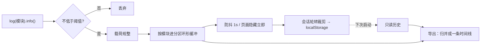
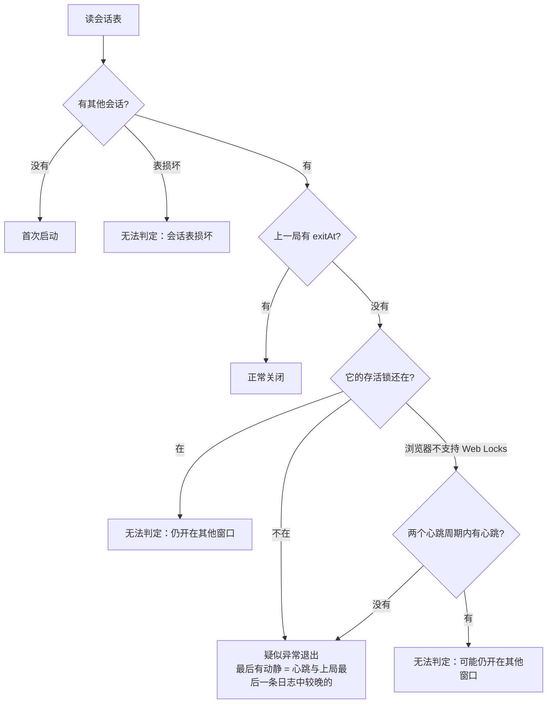

# 日志与诊断

> 基准： 0.7.0 / 2026-10-15

`@nexus-kit/runtime` 的 `/log` 与 `/lifecycle` 两个子路径回答一个问题：用户说「刚才出问题了」「刚才闪退了」，
开发者拿到一个文件，能不能按时间还原现场。目标是三条不变量：**低频的关键事件不会被高频事件挤掉**、
**刷新、升级、崩溃之后上一局的记录还在**、**导出的文件里写明上一局是怎么结束的**。需求证据与分期见
设计稿存档[运行时基础设施](../存档/运行时基础设施_2026-10-14.md)。

## 1. 一条日志的一生

模板里 pwa 控制器检测到新版本，调用 `logs.log("pwa").info("检测到新版本，开确认窗", { reason })`：

1. 当前阈值是 info，这条不低于阈值，往下走；如果是 debug，到这里就丢掉，既不入缓冲也不打印。
2. 载荷规整成纯 JSON 副本：数字、布尔、字符串直接放行；`Error` 展开成名称、消息与截断到 1000 字符的堆栈
   （默认序列化会把它变成 `{}`），BigInt 转字符串；带循环引用的换成「无法序列化」说明文字，超过 2000 字符
   的截断并注明原长。所以后面的持久化和导出不会因为这条记录失败。序列化发生在截断之前，别把大对象整个传进来。
3. 记录补上时刻（墙钟，但单调不减：系统校时回拨也不打乱时间线）和会话号，按模块名找到分区推进环形缓冲。宿主没声明分区时只有一个默认区（2000 条）；
   声明了的话，例如把 `combat` 单独放进 3000 条的高频区，命中结算再多也只淘汰高频区自己最旧的记录。
4. 打印到 console，并标记待落盘。1 秒内的多条记录合并成一次写入；页面隐藏或 `pagehide` 时立即写。
5. 写入前裁剪：只留最近 3 个会话（含本次）；序列化后超过 40 万字符就整段淘汰最旧的会话，只剩本次仍超才从
   本次最旧的条目开始丢。这就是浏览器里的日志轮转——轮转单位是会话。
6. 其他会话的记录——上一局的，或同一应用开在另一个窗口里的——每次落盘和导出时都从 localStorage 现读
   （原文没变就复用上次的解析结果），不进本次的环形缓冲。所以本次的高频事件挤不掉它们；两个窗口各自落盘时，
   写回的是「对方最新的 + 自己的」，不会互相覆盖。每条的序列化长度只算一次，落盘裁剪不重复序列化。

写盘失败（配额满、隐私模式）不抛错、不打断页面：先降级重试一次——只留本会话、预算减半——宿主数据把配额挤满时，
至少本局的现场还能留下（代价：存储里其他窗口、上一局的记录被这次写入冲掉，它们的窗口下次落盘时只能补回自己
内存里还在的部分）；仍失败才计入失败次数与原因。第一次出问题时打一条 console 警告。读回时遇到坏数据跳过坏
条目并记下原因。这些都写进导出文件头部，排查的人能知道「日志可能不全」。

详细日志由 URL 打开：`?log=debug` 把阈值改为 debug，并只记在 sessionStorage 的 `<键>.level`——本会话有效，
重开页面回到 info，免得忘了关一直刷。

## 2. 上一局是怎么结束的

`startForensics` 在渲染之前调用，维护一张会话表（localStorage `<前缀>.sessions`），每个会话一行：

| 字段 | 何时写 |
|---|---|
| `openAt` | 启动时写本行 |
| `aliveAt` | 每 30 秒、以及切到后台时刷新 |
| `exitAt` | `pagehide` 时写；从往返缓存恢复时撤销 |

每次更新都是「读整表 → 只改本行 → 写回」，表里只留本局、最近 5 个其他会话和仍在运行的会话。同一应用同时开在
主屏 PWA 和浏览器标签里时，各写各的行，互不覆盖。

本局另外持有一把 Web Locks 锁 `<前缀>.alive.<会话号>`，回调返回的 Promise 不结束，所以页面活着锁就一直在；
进程被杀时浏览器自动释放，`pagehide` 时本局主动释放（页面在离开或进往返缓存，都不算还在运行），从往返缓存
恢复时重新拿。持锁不影响往返缓存：本机 Chrome 实测持锁页面照样从往返缓存恢复；主动释放是为了在其他浏览器上也
不依赖这一点。下次启动先读表，取「本局之外最近开启的那个会话」当上一局，再查询当前被持有的锁：

例子：用户正在用，应用闪退，用户马上重新打开。上一局 5 秒前刚有心跳，只看心跳分不清「还开着」和「刚死掉」；
但它的锁已经随进程释放，所以判疑似异常。锁查询是异步的：`verdict` 先给不看锁的初值，`settled` 落定后更新（查询 3 秒不返回就按
心跳规则落定并记 warn）；导出的「上次退出」一节总取最新值。宿主要读判词时读 `forensics.verdict` 或等 `settled`，
不要在启动时解构出一份快照。判词只针对最近开启的那个会话：多窗口时，更早崩溃的会话会被它盖住，不再单独报告。不支持 Web Locks 的环境（Safari 15.4 以前）退回心跳规则。

疑似异常只说明缺少正常关闭的凭证，不证明死因或死亡时刻：Safari 没有 freeze/resume 事件，系统杀进程时
`pagehide` 不保证执行，用户从多任务里划掉也表现为没有告别。所以导出文件里写的是「最后有动静」，不是
「死于」。从往返缓存（bfcache）恢复的页面是同一局复活，`pageshow` 带 `persisted` 时撤销 `exitAt`，
否则下次会把仍在运行的这一局误判为正常关闭。

判词注册成日志导出的「上次退出」一节，落定时写一条 lifecycle 日志（疑似异常记 warn）。会话表读写失败不抛错，
同一失败原因只记一次日志——存储满时开启、心跳、告别都会失败，不能每 30 秒刷一条。

## 3. 未捕获异常

`captureGlobalErrors(store)` 监听 window 的 `error` 与 `unhandledrejection`，把消息、堆栈（经第 1 节的 Error
规整）和出错位置记成 `error` 模块的 error 日志。限频按固定的一分钟窗口：同一条消息每个窗口只记一次；每个窗口
逐条记录的总数有上限（默认 20），超出的只计数。窗口翻转时补记两类汇总——某条消息又重复了几次、超出上限压下
了几条——然后清空本窗口的记账，记账不随运行时间增长，刷了一阵就停的报错也不丢次数。一个死循环里
的报错因此不会把启动、存档、升级这些低频记录挤出缓冲。

## 4. 导出与交付

`store.exportText()` 产出一个文本：头部是导出时间、本次会话号、宿主给的环境行（模板加了版本与构建号，
默认行是 UA、页面来源与路径、屏幕与 dpr）、日志级别、持久化健康、
各分区淘汰数；然后是宿主注册的摘要节（如「上次退出」）；最后是按会话分段的日志行，每行
`YYYY-MM-DD HH:MM:SS.mmm LEVEL [模块] 消息 {数据}`，人能直接读，也能按行解析。日志之后是宿主经
`registerAppendix(名字, 生成函数)` 登记的附录，每个附录一个 `## 名字` 小节，用来放体积大、给机器读的数据（模板里
是性能数据 JSONL，见[性能采集](性能采集.md)）；生成函数抛错时该小节写「生成失败」和原因，不影响其余内容。
`exportText({ appendix: false })` 不带附录，复制到聊天走这条。导出前对全文做一次兜底：出现的每个 http(s) URL 只留来源与路径，去掉查询串、
片段和用户名密码——消息和载荷是自由文本，可能带着令牌。

导出有三条路，都放在诊断面板（`openDiagnosticsPanel`）里让用户点——复制和分享都要求用户手势，按钮点击本身就是：

| 按钮 | 做什么 | 什么时候失灵 |
|---|---|---|
| 发送诊断文件 | `deliverTextFile`：触屏设备（主要指针是粗指针）先试系统分享，桌面直接下载；分享不支持或不在手势里被拒时退回 `<a download>`，object URL 30 秒后回收 | 微信这类内置浏览器分享与下载都可能没反应 |
| 复制诊断内容 | `copyText`：剪贴板 API 优先，没有或被拒时退回隐藏文本框 + 复制命令 | 两者都被禁时返回失败，面板提示改用发送 |
| 关闭 / 重新加载 | 弹层模式关闭面板；整页模式重新加载 | — |

复制的内容可以和发送的不同（`getCopyText`）：聊天应用贴不进太长的文本，日志多时全文有几十 KB。模板复制的是
`truncateExport(全文, 1 万字)`：头部摘要（环境、上次退出）完整保留，日志只取最近的整行，保留部分前补上它所属会话
的分隔行，并在日志节开头注明省略了多少行；最后一行本身就超长时截前半段。省略说明的措辞由宿主给（模板写「完整内容
请用『发送诊断文件』」或「下载诊断文件」，与按钮名一致）。按钮因此叫「复制诊断内容」而不是「复制全部内容」。
1 万字这个上限没有对各聊天应用实测。

下载拿不到「成功」的信号，所以结果叫 `downloaded`，含义是「已触发下载」，面板文案如实说「已开始下载」，并告诉
用户去哪找、没找到就改用复制。用户在分享面板里取消算取消，不追加下载。文件一律 `.txt`：安卓分享只认少数扩展名。
每次点按钮都现取全文与文件名（面板开着期间日志还在增长）。

面板是原生 DOM 加内联样式，不依赖 React 和应用 CSS：白屏兜底时它们都可能没起来。弹层模式可关闭、Esc 关闭；
整页模式铺满屏幕、不可关闭，只给「重新加载」。弹层点遮罩也能关（手机上的习惯）。同一时刻只开一个面板。处理中两个按钮都禁用：双击「发送」时第二次
分享会因为上一次还没结束而失败，落到下载兜底，平白多下一个文件。焦点：打开时进面板，Tab 在面板按钮间循环，
关闭后还给打开前的元素。文案全部由宿主传入。

模板的文案有三条约束：按钮在触屏设备上叫「发送诊断文件」、桌面上叫「下载诊断文件」，与实际行为一致；每条失败
提示都给出不绕回原处的退路（微信等应用内浏览器里分享、下载、复制都可能不灵，最后的路是「在浏览器打开」）；
说明里如实列出导出了什么，不承诺「不含个人数据」——kit 只去掉 URL 查询串，管不了宿主自己写进日志的内容。

复制的退路（隐藏文本框 + 复制命令）照 iOS Safari 的要求写：用 `setSelectionRange` 全选、字号 16px 免得聚焦时页面
缩放、复制后还原焦点。这条退路只在单测里验证了接线，iOS 与微信内置浏览器上的实际效果没有实测；e2e 走的是
Chromium 的剪贴板 API。

模板把主动入口放在版本号上：2 秒内连点 5 次打开弹层面板（`components/VersionBadge.tsx`），不占界面。入口靠
开发者口头远程教用户操作，所以点的过程有反馈：从第 3 下起提示「再点 N 次」；点按区比文字大一圈，并关掉双击
缩放。提示浮在页脚上方、不参与排版：如果提示挤动页脚，版本号会离开原位，手指按原坐标继续点就点空了（e2e 按
固定坐标连点钉住这一点）。

## 5. 白屏兜底

「一打开就白屏」最需要诊断文件，却连版本号都看不到。`installCrashFallback` 管两条触发路：

- **挂载前出现未捕获异常或没人处理的 Promise 拒绝**（入口代码抛错、动态导入的模块加载失败）：先记一条 error
  日志（`captureGlobalErrors` 也会记原始异常，两条同源），给 1.5 秒宽限，期满仍没 `markMounted`、并且页面确实是
  白的（宿主给的 `isBlank`，模板是「`#root` 没有子元素」）才显示——浏览器扩展、微信注入脚本之类的无关报错不该
  把正常起来的页面盖掉；宿主先读存档再挂载、慢于宽限期时，已经画出内容的页面也不算白屏。慢机上挂载可能超过宽限期：兜底已经显示、随后 `markMounted` 到了，
  就撤下兜底并记一条 warn，不让一个不可关闭的整页永久盖住其实正常的应用；撤下时清掉「已显示」标记，之后
真正的渲染崩溃仍能再显示兜底。代价是慢启动的宿主在「挂载前有无关报错」时会看到兜底闪现，接入规范因此要求
慢启动宿主挂载前往 `#root` 画加载态。跨域脚本的报错浏览器只给
  「Script error.」，兜底原因换成「跨域脚本报错（浏览器不提供详情）」。
- **界面渲染崩溃**：React 遇到渲染抛错会卸掉整棵树。模板在根上包了错误边界（`components/ErrorBoundary.tsx`），
  接住后连同 React 的组件栈调 `report`，立即显示，不会被撤下。错误边界挂载成功时调 `markMounted`，之后的普通
  异常只进日志、不触发兜底。

兜底只显示一次；显示前先把日志落盘。界面由宿主画，模板用整页诊断面板。用户刚好开着弹层面板时界面崩溃，整页面板
会顶替弹层——否则用户关掉弹层，底下就是白屏，兜底也不会再出现。顺序要紧：`main.tsx` 第一行导入 `observe.ts`，
ES 模块按导入顺序执行，兜底在其他模块之前就装好。

**重新加载到最新版。** 模板的 SW 是提示升级制，修复版下载好后处于等待状态，要用户在升级弹窗里确认才接管；兜底时
升级弹窗已经不在（挂载前崩溃时连升级检查都没跑），单纯刷新拿到的永远是坏的旧版。兜底页的「重新加载」因此走
`reloadLatest`（`@nexus-kit/runtime/boot`；runtime 里的入口是 `reloadToLatestVersion`）：

1. 按钮变暗、改成「正在检查新版本…」，然后检查一次更新。
2. 检查结束时既没有下载中也没有等待中的新版本——这是最常见的情况（数据问题、代码缺陷，并没有修复版）——立即刷新，
   不白等。
3. 新版本正在下载：按钮改成「正在下载新版本…」，等它装好（不抢着激活一个更旧的等待版本）。
4. 拿到等待中的新版本：发 `SKIP_WAITING`，等接管信号后刷新；页面没被 SW 控制时收不到接管信号，激活后稍等即刷新。
5. 全程受 15 秒时限约束，另有一道绝对时限兜住任何一步不返回（iOS 上取 SW 注册信息偶尔一直不返回）：按钮点了一定
   刷新，且只刷新一次。

这是「升级必须用户确认」的唯一例外，见需求裁决。说明里仍保留「还不行就关掉页面重新打开」：修复版还没发布时，
刷新也救不了。

**主包加载失败**（404、断网且没有 SW 缓存、旧浏览器解析不了语法）时整个模块图都不执行，上面的兜底也没装上。
这一段由注入 `index.html` `<head>` 的内联脚本接：模板的 `vite.config.ts` 用 `transformIndexHtml` 注入
`bootGuardScript(文案)` 的产物，赶在主包 `<script>` 之前执行。主包一开始执行，`observe.ts` 调 `markBooted()`：给
`<html>` 打 `data-boot`，内联脚本从此不再出手，已经弹出的「加载失败」页同时撤下（慢网下主包晚到时它可能已经弹出）。
在那之前：模块脚本（主包）加载报错立即显示；页面级未捕获错误（旧浏览器解析不了语法等）后 2 秒仍没启动才显示；
15 秒始终没启动也显示。图片、样式表、普通脚本的加载失败不算。这一页导不出诊断（runtime 没加载上），只有说明和
「重新加载」。

内联脚本和 runtime 用的是**同一份源码**：`boot/guard.ts` 里的 `reloadLatest` 与 `bootGuard` 只用 ES5 语法、只引用参数
与全局对象，`bootGuardScript` 靠 `Function.prototype.toString` 取源码拼成内联脚本。只用 ES5 是因为这段脚本要兜住的
恰恰包括解析不了新语法的旧浏览器；单测用 ES5 解析器校验生成的脚本，并独立运行它。开了 CSP 的部署要给这段内联
脚本放行（hash 或 nonce），它的样式写在元素的 `style` 属性里，`style-src` 也要允许。

## 6. 离开前限时保存

`leaveAfterSave(save, leave, { timeoutMs })`：保存完成才执行离开；保存失败或超过时限（默认 5 秒）都抛错、
不离开，调用方提示用户重试。超时后第一次保存可能仍在后台进行，用户重试会再发起一次，所以 save 必须幂等
（重复保存同一份快照无害），或由调用方自己加互斥。保存可能既不完成也不失败（IndexedDB 悬挂），没有时限的话用户点完按钮会卡在
既没离开也没提示的状态。

## 7. 验证

单测覆盖分区淘汰（含循环写满多圈）、会话轮转与预算裁剪、级别来源、载荷规整（Error、BigInt、循环引用、
超长）、写盘降级与失败记账、两个窗口共用存储、时钟回拨、导出去查询串、判词推导（含 Web Locks 落定与心跳
退回）、会话表裁剪、bfcache 撤销、心跳与 dispose、存储属性访问即抛、异常限频、分享与下载兜底、按设备选分享或下载、复制两级退路、面板两种模式、兜底的宽限与只显示一次。真浏览器
`pnpm e2e` 的诊断一条（`scripts/e2e-diagnostics.ts`）：刷新后上一会话的日志读回；CDP `Page.crash` 杀掉渲染
进程（不触发 `pagehide`）后马上重开，判词为疑似异常；页面里抛一个未处理的 Promise 拒绝，消息里带
`?token=secret` 的 URL；连点版本号下载的诊断文件含三个会话、会话一那段有「页面告别」而会话二那段没有、
异常已记录且 `secret` 不在文件里；面板里点「复制诊断内容」后读剪贴板是完整诊断文本；让入口代码拿不到 `#root`
（启动即抛错）时出现整页兜底，从兜底页导出的文件记着启动失败原因；屏蔽 SW 后拦掉主包，内联「加载失败」页立即
出现；样式表失败加主包晚到不误报；页面级报错加主包晚到时「加载失败」页先出现、主包一启动即撤下。升级链 e2e
（`scripts/e2e-upgrade.ts`）末尾：用户在 v2、服务器换成 v3、页面启动即崩出现兜底页，点「重新加载」直接进 v3
（反向验证过：同样场景只普通刷新会停在旧版）。渲染崩溃那条路由错误边界的单测覆盖。iOS 上 `pagehide` 在系统杀进程时的行为、微信内置浏览器的下载结果只能
真机观察，没有自动化。

## 变更记录

- 2026-10-14 建篇：运行时基础设施第一期（0.4.0）。
- 2026-10-14 导出加附录（`registerAppendix`），性能数据附在日志之后（0.5.0）。
