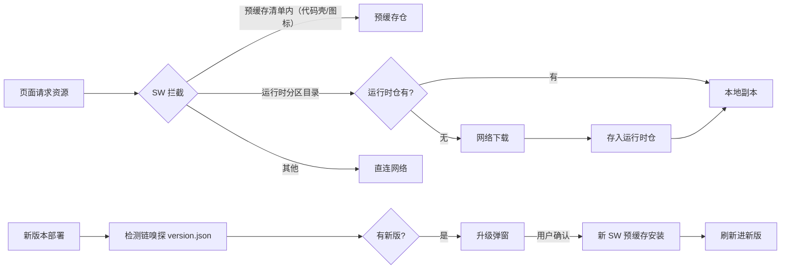
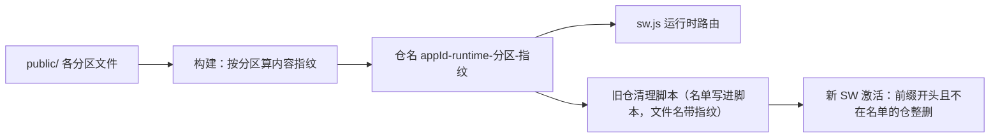
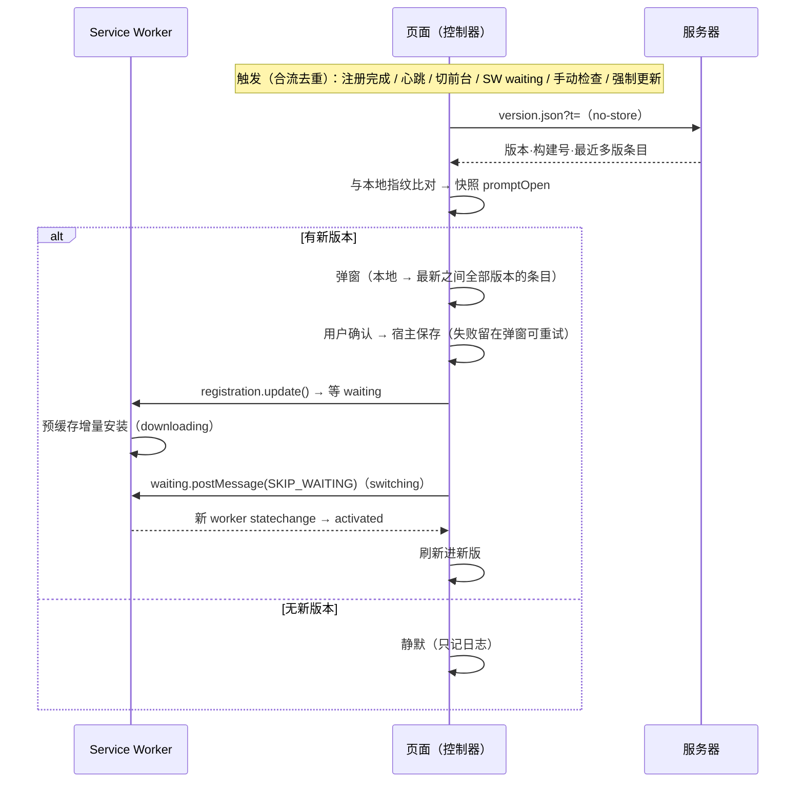
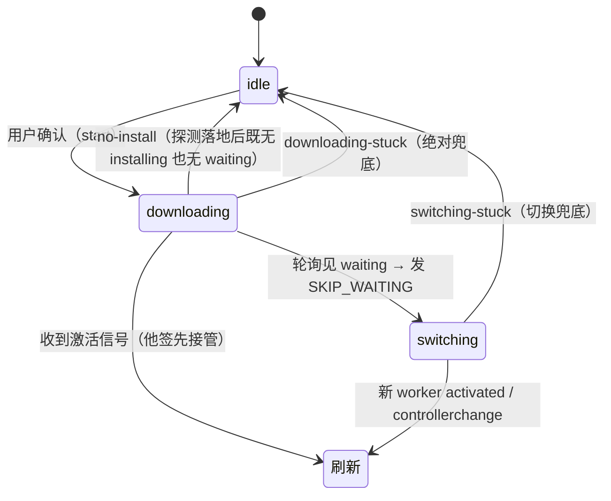

# 离线与升级（PWA 缓存与版本更新链）

> 基准： 0.6.0 / 2026-10-14

这篇讲两件配套的事：应用怎么做到断网可用（离线缓存），新版本怎么送到用户手上（升级链）。
两者共用同一条 Service Worker（下称 SW）生命周期，合在一篇讲。接入方必须遵守的红线见
[接入规范](../规范/接入规范.md)，踩过的坑与对应门禁见[平台坑账](平台坑账.md)。

## 1. 全景

技术选型：vite-plugin-pwa 的 generateSW 模式（底层 workbox），SW 由插件生成、不手写；开发模式
关闭。SW 只在 HTTPS 或 localhost 下生效，局域网 HTTP 访问没有 PWA 能力。

## 2. 缓存策略：壳预缓存、资源按需

- **预缓存（壳）**：index.html、带哈希的 JS/CSS、图标等启动必需的小件，装 SW 时一次下全。
  导航请求由预缓存的 index.html 供给，所以页面的 HTML 和它引用的代码永远是同一代。
- **运行时缓存（按需）**：文件名不带哈希的大体量资源（数据、图集、音频）按分区走 CacheFirst，
  用到才下、下过即存；每个分区一个仓，配条数上限（最久没用先删）与 30 天过期，配额紧张时整仓让路。
- **离线首用补缓存**：SW 推到空闲期才注册（不和首屏抢带宽），此前本会话下的资源绕过了 SW。
  SW 首次装好时，宿主把本会话已下载的同源运行时资源清单经 workbox 内置 `CACHE_URLS` 消息交给 SW
  补存（`warmRuntimeCache`），SW 同时 clientsClaim 接管本页余下请求——用过一次即可断网。
  补存成功才可以对用户说「已可离线使用」，失败不承诺。

## 3. 缓存换新：壳随构建、资源随分区指纹

「发了新版用户看到旧资源」是 PWA 最大的翻车点：不带哈希的文件不会自己过期。两套标记各管一摊，
都由构建实测推出，没有人工维护的版本号：

- **壳**：sw.js 内容随构建变化，浏览器自动重装；预缓存里哈希没变的文件不重下。
- **运行时资源**：仓名 = `<appId>-runtime-<分区>-<分区内容指纹>`。构建时对 public 下每个分区的全部
  文件（相对路径 + 内容）算 sha256 取前 12 位。内容不变仓名不变，发版不洗掉已缓存的资源；内容一变
  仓名必变，新仓从零积累，旧内容不可能被同名仓钉死。

分区按**变化频率**切：常改的小东西单独成区，不连坐体积大、几乎不变的资源。分区由宿主在
`pwa.config.ts` 声明（目录前缀 + 排除前缀 + 上限），声明先校验两两不相交，同一组正则既生成
sw.js 路由，也决定文件归哪个分区算指纹。

- **旧仓清理**：workbox 的 `cleanupOutdatedCaches` 只清预缓存仓。运行时仓由构建生成的
  `pwa-runtime-cleanup-<指纹>.js`（sw.js `importScripts` 引入）在 activate 时清：本应用前缀开头而
  不在本版名单的仓一律删除。名单写进脚本、文件名随名单变，任何 HTTP 缓存都递不出旧名单。删错的
  唯一后果是重下资源；清理失败只记日志不阻断激活。
- **构建对账**：`verifyPwaBuild` 按 public 实测重算分区指纹，断言 sw.js 含每个仓名、清理脚本在
  dist 根且被引入；有分区没有文件直接失败。
- **边界**：分区路由只认同源（正则从路径开头匹配，跨源同形路径也会命中），引入跨域资源前须先
  补来源约束；HTTP 层缓存（CDN/浏览器）给旧字节不在本机制内，由部署缓存头红线管。

## 4. 升级链：检测 → 弹窗 → 下载 → 切换 → 刷新

### 4.1 检测与比对

- 判定核嗅探 `version.json` 即答（请求有超时，弱网下手动检查不会长时间没反应），SW 壳探测放后台不等待——壳探测命中时要等整个新壳装完才返回，
  弱网数十秒，同步等它会拖住手动检查。嗅探拿不到说明时，SW 已有 waiting 也算有更新。
- **比对规则**：版本号不同 → 取远端条目里比本地新的全部版本，按新到旧分组展示，超出上限的折叠；
  本地比远端新（回滚部署）不提示。版本号相同而远端构建号更大（同版本重发）→ 比本版对外条目指纹：
  一致 = 「问题修复更新」（不重列用户已有的条目）；不一致 = 「本版内容有更新」（列现行条目）；
  远端该版没有对外条目 = 用户无感，不打断。
- 本地版本带 `v` 前缀、远端不带，比对前归一；产品版本只用纯 `X.Y.Z`。

### 4.2 弹窗时机

控制器快照的 `promptOpen` 是唯一开关：检测命中即开；宿主 `setPromptBlocked(true)` 期间只记
「有更新」不开窗，解除时补开；用户「稍后」过的同一构建在本次打开期间不再自动开（有效期 24 小时，防长时间不重开的会话永久静默；只存内存，重开应用即重置），新构建立即开，手动检查
命中强制重开；升级进行中任何命中都不开窗（会压在进度幕布后面）。「稍后」之后宿主据 `needRefresh`
显示一个「有新版本」入口，点了 `reopenPrompt` 直接重开，不重新请求网络。

### 4.3 升级状态机

- **接管信号**：prompt 制下新 SW 激活后本页 `controllerchange` 未必触发，刷新押在新 worker 的
  `statechange → activated`，`updatefound` 给确认之后才出生的 worker 补挂，`controllerchange` 作补线。
  确认当下 waiting/installing 皆空时，只有「active 不是本页控制者」或「本页控制者已不是加载时那个」
  才算新 SW 已被其他标签页激活；active 就是本页控制者说明新 SW 还没下来，立即刷新只会回到旧版。
- **三道兜底**（都走 onFail 复位，宿主收起幕布、恢复按钮、给出原因，绝不把用户锁住）：探测落地后
  短时内既无安装也无 waiting = 服务器上没有可装的新 SW，提前收口；installing 在跑时跟着真实进度等，
  只受绝对兜底约束；switching 后迟迟不激活 = 接管卡死。
- **保存段**（React 绑定）：确认后先跑宿主保存钩子，保存有超时，失败、抛错、超时都按「保存失败」
  给出可见原因并放开按钮重试；保存期间「稍后」可点，点了即取消本次升级，保存落地后也不开跑。一旦进入
  下载/切换阶段，「稍后」失效——用户已授权刷新，放他回去等于埋一个随时会刷新的雷。
- **重入闸**：确认即占用，防双击叠两次。
- **升级成功确认**：刷新前记下旧版本，新版本启动时 `consumeUpdatedNotice` 读到且版本确实变了才提示一次
  「已更新到 vX」，读完即清；版本没变（升级没生效）不报喜。
- **无 SW 注册**（首访、`?nosw=1` 已反注册、环境不支持）：确认后直接刷新——没有预缓存钉着，刷新拿到
  的就是服务器最新构建。
- **强制更新**：入口由宿主自行挂载（模板不内置）。点击即授权（等同在弹窗点确定），先按浏览器真实注册接管 SW 再判定（只看本会话变量会
  把持有旧壳的回头客误判成无 SW），命中后先跑保存钩子，保存失败或超时只记日志照常更新——强制更新
  是逃出旧版缺陷的出口。

## 5. version.json 合同

构建时 `nexusPwa` 解析 CHANGELOG 写出 `dist/version.json`：版本、构建号、构建时间、最近若干个已发
版本的对外条目（新版本在前）。字段类型以 `@nexus-kit/pwa` 的 `parseVersionManifest` 为准。

- 「内部：」「WIP：」开头的条目只留档，不进 version.json；全是留档条目的版本不进历史。
- 可选的未开放功能泄漏门禁：Unreleased 与当前版本的对外条目提到登记的关键词即构建失败。
- **白屏兜底的例外**：新版本只在用户于升级弹窗里确认后接管，唯一例外是白屏兜底页（`@nexus-kit/runtime` 的整页
  诊断面板与模板 `index.html` 的内联兜底）上的「重新加载」：应用已经起不来、升级弹窗不在，单纯刷新拿到的永远是
  坏的旧版，所以用户点了它就先给等待中的新 SW 发 `SKIP_WAITING` 再刷新。机制见[日志与诊断](日志与诊断.md)。
- **缓存红线**：version.json 不进预缓存（进了就被钉死在安装时的内容，升级探测永远失明），请求带时间戳
  且 `cache: no-store`，服务器侧同样禁缓存。
- 运行时把它当外部数据：顶层非法按「无更新」处理并记日志，单条目非法剔除降级。

## 6. 验证开关与存储保障

- `?nosw=1`：反注册已装 SW、清空全部 Cache Storage、本轮不注册；清到东西时自动重载一次
  （sessionStorage 防循环）。实机验收一律带它，绕开「旧壳让改完的代码看不见」。
- 用户产生值得保存的数据后申请 `navigator.storage.persist()`，被拒不阻塞。

## 7. 安装为应用与全屏

- **manifest**：display standalone、start_url、图标 192/512 与 maskable；由 `nexusPwa` 写出并注入
  manifest link。
- **安装引导**：Android/桌面捕获 `beforeinstallprompt` 走原生安装，该事件只能用一次，无论用户接受还是
  取消都作废、入口隐藏，等浏览器下次派发再出现；iOS 无原生事件，给图文引导，按版本记忆「本版已关闭」。
  iOS 上按浏览器分支：Safari 的分享按钮位置随系统版本与机型变化，文案不写死位置；Chrome/Edge 等在地址栏
  一侧；微信/QQ 内置浏览器没有「添加到主屏幕」，先引导「在浏览器打开」。已以独立窗口运行时一切引导隐藏。
- **iOS 存储隔离**：Safari 与主屏应用的本地数据是两份，互不相通。用户在 Safari 里攒下的数据，装到主屏后
  打开是空的。所以 iOS 引导尽量放在首次使用早期，引导里写明「这里的记录不会自动带过去」，有本地数据的
  应用提供导出/导入。
- **iOS 全屏**：`apple-mobile-web-app-status-bar-style: black-translucent` 让画面铺满、状态栏悬浮其上，
  这也是 `env(safe-area-inset-*)` 在 standalone 下取到非零值的前提。这些 meta 在「添加到主屏幕」那一刻
  固化，改了要删图标重装。
- **视口缺口**：black-translucent 下 layout viewport 高度仍按「屏高 − 状态栏」算，`100%`/`100vh`/
  `100dvh` 都少一截，只有 `100lvh` 是完整屏高；用 `@media (display-mode: standalone)` 限定（Safari 标签页
  里 lvh 会超出可见区）。补缺口靠文档流（根容器 absolute 铺满 body），不能靠 fixed——iOS 把 fixed 裁在
  layout viewport 内。不要用 JS 量屏高差再撑高：要嗅探平台，且撑高发生在启动期会让画面跳一下。
- **安全区统一吸收**：可交互 UI 放进一个安全区容器，由它统一 padding `env(safe-area-inset-*)`，子元素
  只按容器坐标布局，不各自叠加安全区变量。

## 变更记录

- 2026-10-13 「稍后」有效期定为 24 小时；强制更新入口交宿主挂载。
- 2026-10-13 补保存段超时与取消、「有新版本」重开入口、升级成功确认、安装事件单次使用、iOS 浏览器分支与存储隔离。
- 2026-10-13 建篇：由 旧项目A《离线与升级》与 旧项目B《PWA 与即时更新》的机制合并通用化。
