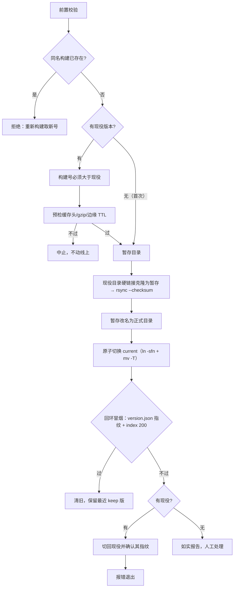

# 部署与回滚

> 基准： 0.7.0 / 2026-10-15

`nexus-devflow deploy` 把应用的 dist 部署到自有服务器。目标是三条不变量：**任何时刻线上都指向一个
完整版本**、**新版不通过冒烟就自动退回旧版**、**更新链关键文件永远不被缓存**。

## 1. 服务器布局

```
/var/www/<app>/
├─ releases/
│  ├─ 1.2.0+41/        每次部署一个完整目录，名字 = 版本+构建号
│  ├─ 1.2.1+44/
│  └─ .upload-1.2.2+47/ 上传中的暂存目录（中断只留它，下次重跑先清掉）
└─ current -> releases/1.2.1+44   nginx root 指向它
```

nginx 只监听 127.0.0.1 的端口，对外经隧道或反代发布；部署冒烟走服务器回环，不受公网链路影响。
站点样板在 `packages/devflow/templates/nginx.conf.example`。

## 2. 流程



- **前置校验**：只在主仓（非工作树）、指定分支、工作树干净时部署；dist 的 version.json 版本必须等于
  package.json；bundle 里必须有与 version.json 同值的构建号字面量（同一次构建写出的两处互证，防半新
  半旧的 dist）。
- **构建号单调**：升级检测只认「本地构建号 < 远端构建号」。计数器不入 git，丢了重建会回退，号回退的
  版本上线后老用户的升级弹窗永久失明——所以部署前对现役目录名硬校验。
- **增量上传**：vite build 会刷新所有文件的 mtime，rsync 默认按大小 + mtime 判定会全量重传。先在服务器
  把现役目录硬链接克隆成暂存目录，再用 `--checksum` 只比内容：未变文件零传输、硬链接保留；变了的文件
  写全新 inode，不碰旧版目录。需要真正的 rsync（macOS 自带的 openrsync 不够，`brew install rsync`）。
- **原子切换**：先建临时软链再 `mv -T` 覆盖 current，任何时刻 current 都指向完整目录。
- **回滚**：冒烟失败自动切回部署前的目录并回读指纹确认；回滚本身失败时把两个原因都打出来，提示立即人工
  切回。手工回滚同理：`ln -sfn` 到旧目录 + `mv -T`，秒级，无需重新部署，切完必须冒烟确认指纹。

## 3. 缓存头红线

| 文件 | Cache-Control | 原因 |
|---|---|---|
| `/`、`index.html`、`sw.js`、`version.json`、`manifest.webmanifest` | `private, no-cache`（version.json 加 `no-store`） | 更新链：任何一层缓存给旧内容，升级就失明。CDN 的「浏览器缓存 TTL」覆写会踩掉单独的 no-cache，`private` 才能保持始终协商 |
| `/assets/*`（带内容哈希） | `public, max-age=31536000, immutable` | 文件名即版本 |
| 其余不带哈希的文件 | `no-cache` | 浏览器 HTTP 缓存与 SW 运行时仓双层，HTTP 层每次协商 |

部署前对现役响应逐个预检 `privateRequired` 路径带 private、`gzipRequired` 路径 gzip 下发、公网
`edgeTtlProbes` 文件没被 CDN 注入 `max-age`。这些是服务器与 CDN 配置，与发哪一版无关，所以在动线上
之前查：切换之后才发现，回滚也没用（旧版同样缺）。改 nginx 或 CDN 规则视同改门禁，必须线上验证。

## 4. 配置

部署参数在宿主仓库根 `nexus.config.json` 的 `deploy` 段，字段与默认值以 `@nexus-kit/devflow` 的
`parseNexusConfig` 为准；`NEXUS_DEPLOY_TARGET/ROOT/PUBLIC_URL/KEEP` 环境变量可临时覆盖。远端路径与探针
路径只允许安全字符（会拼进 ssh 命令）。ssh 凭据走本机 ssh 配置，不进任何文件。

## 变更记录

- 2026-10-13 建篇：由 旧项目A `scripts/deploy.mjs` 与交付规范 §7 通用化。
