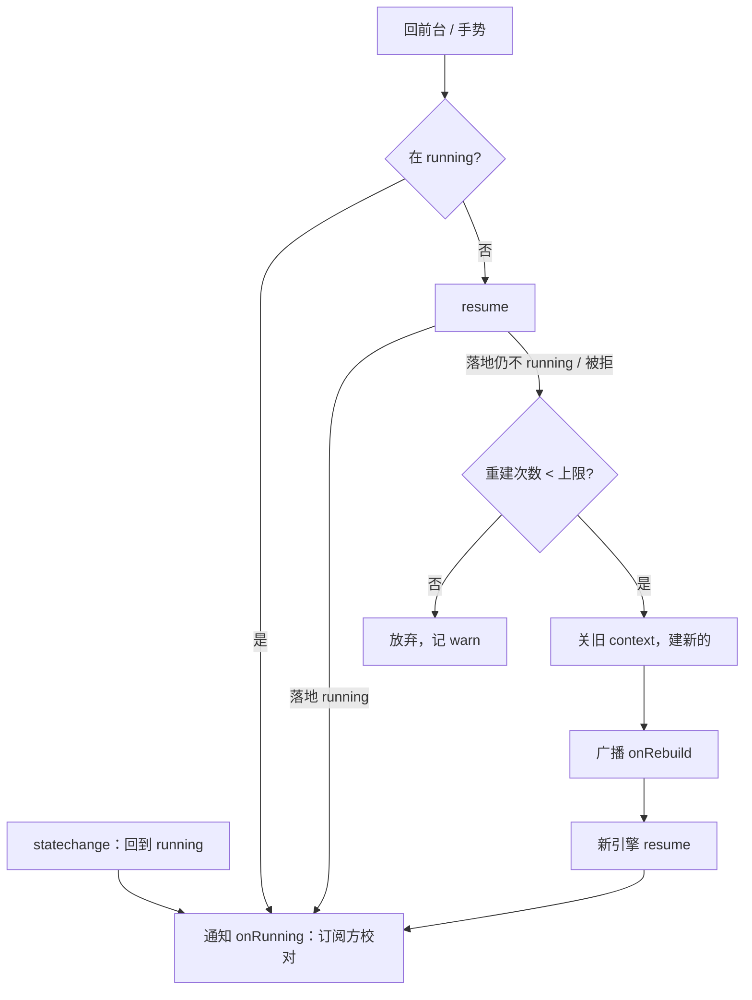

# 音频

> 基准： 0.7.0 / 2026-10-15

`@nexus-kit/runtime/audio` 回答一个问题：**声音在真机上为什么会哑，以及怎么自己好回来**。浏览器要求手势
解锁、iOS 切后台会把引擎打进标准之外的状态、系统会掐死正在循环的音乐、引擎会卡进唤不醒的死态——这些
都不会报错，只是没声。取材旧项目A与旧项目B的音频实现及真机实测结论。

模块分两层。**引擎宿主**（`createAudioHost`）只管 AudioContext 的生命周期，合成类宿主（旧项目B的振荡器）
只用这一层：拿 `host.context` 和总线自己接节点。**样本播放器**（`createSamplePlayer`）建在引擎宿主上，
管音频文件（旧项目A 的音效与背景音乐）。音量偏好的解析与序列化是一组纯函数（`prefs.ts`）。

## 1. 一局游戏走一遍

宿主建 `createAudioHost({ buses: ["music", "sfx"] })` 和 `createSamplePlayer({ host, loader, urlOf })`。

1. 标题页加载完，宿主调 `playMusic("title")`。这时还没有 AudioContext：播放器只记下「应当在响的是 title」。
   顺手点的音效 `play("click")` 直接丢掉——解锁前本就不该响。
2. 玩家点「开始游戏」，宿主在这个点击里调 `host.unlock()`。引擎宿主创建 AudioContext、建好主音量和两条
   总线、resume。引擎进入 running 后通知订阅方，播放器按记下的意图起播 title。
3. 进图后宿主调 `warm(热清单)`，这些音效经 `/assets` 调度器以空闲档排队，下载解码进缓存，不抢首屏的带宽。
   打怪时 `play("hit")`：缓存里有就立刻响；没有就直接下载（不排队），300ms 内解完才补播，晚了就丢。
4. 玩家切到别的 App 再回来。iOS 把引擎打进 `interrupted`，回来时引擎宿主 resume，回到 running 后通知播放器。
   第二次切后台时，系统把正在循环的背景音乐声源整个掐死；回来后播放器发现「意图还在、声源没了」，
   按意图重新播。
5. 某次回来，resume 落地了引擎仍然不在 running。引擎宿主关掉旧 AudioContext、建一个新的，广播重建。
   播放器清掉旧引擎上的缓存、节点和限频账，新引擎跑起来后按意图续上音乐。

## 2. 引擎宿主

**解锁。** 浏览器只允许在用户手势里启动音频。`unlock()` 幂等：第一次调用时创建 AudioContext（老 Safari 用
`webkitAudioContext`，环境不支持就全静默并记一条日志）；之后再调，引擎不在 running 就 resume。

**回前台恢复。** iOS Safari 切后台或锁屏会把 AudioContext 打进 `interrupted`，这是标准三态之外的第四种状态，
只判 `suspended` 就永远唤不醒。所以回前台（`visibilitychange` 变为可见）和手势时，判据是「不在 running 一律 resume」。
iOS 上 `visibilitychange` 会漏触发，而系统自己把引擎从 `interrupted` 恢复到 running 时会发 `statechange`（旧项目B真机
实证），所以引擎宿主同时监听 `statechange`，但只用它做一件事：状态回到 running 时通知所有 `onRunning` 订阅方。
`statechange` 变成非 running 时不去 resume：页面在前台时引擎被打断（例如来电），这时 resume 只会失败，接着会把
重建次数耗光，来电结束后反而救不回来；恢复交给系统的 `statechange`、下一次回前台和下一次手势。WebKit 有时在页面隐藏期间自己恢复了 running，回前台时没有状态变化；这时也照样通知，因为后台期间
声源可能已被掐死。同一次恢复可能从 `statechange` 和 resume 落地各通知一次，订阅方的处理必须幂等。

**假死重建。** 旧项目A 真机上引擎会卡进 resume 无效的死态，点屏幕也救不活。resume 落地后仍不在 running，或者
resume 被拒，引擎宿主就关掉旧 AudioContext、建一个新的，然后广播 `onRebuild(新context)`。新引擎不带旧会话的
死态。重建整个会话最多 3 次（`maxRebuilds`），超过就放弃并记 warn，避免死循环。

**发声前置门。** 引擎挂起时，把音符排在冻结的时间轴上是哑的（两个项目都踩过）。`whenRunning(fn)` 在 running 时
立即执行；挂起时先 resume，落地 running 且引擎没被换掉才执行，否则返回 false。resume 被拒记一条 info（同一个引擎只记一次，
引擎挂着时每个音效都会撞上）。`fn` 抛错（节点所在的引擎刚被关掉）不外泄：记 warn 并返回 false，调用方 `void` 掉返回值
也不会出现未处理的拒绝。

**总线与下潜。** 每条总线的增益 = 偏好里的音量 × 下潜系数，主音量在静音时为 0。`duck(总线, 来源, 系数)` 按来源
登记下潜，多个来源同时在时取最深的一档，全部撤销（传 null）才回升。旧项目B的经验：倒计时紧迫和开麦都要压低
音乐，只用一个开关时，一个来源撤销会把另一个来源的下潜也撤掉。

**两个可选能力。** `suspendWhenHidden: true` 时，切后台先 0.3 秒淡出再挂起引擎（省电），回前台恢复；这是引擎宿主
自己挂起的，不算假死。0.3 秒内就切回来时引擎还没挂起，但淡出渐变还排在时间线上，直接给增益赋值挡不住它；所以每次
设置主音量前先撤掉时间线上没执行的渐变。`resetSession()` 处理 iOS 停麦后的音量劣化：结束麦克风采集后，系统把输出压到极轻，引擎
状态却还是 running；挂起 120ms 再恢复，逼系统重建音频会话（旧项目B真机实证）。

## 3. 样本播放器

**解码缓存。** 解码后的音频是 float32 PCM，体积 = 采样数 × 声道 × 4，一首三分钟的立体声曲子约 60MB。缓存按字节
预算（默认 32MB）做 LRU，同一个文件正在下载解码时，后来的请求共用结果。缓存字节登记为 `/perf` 水位指标
`audio.decodedMB`。引擎重建时缓存全部清空：AudioBuffer 能不能在新的 AudioContext 上复用，WebKit 不保证。解码在开始等字节之前就记下
当时的引擎；下载期间引擎被换，这份结果作废，不会到新引擎上解码入缓存。

**失败分级。** HTTP 错误码与解码失败是文件本身的问题，记一条 warn 后永不重试，否则怪堆里同一个缺失音效每秒触发
几十次，就是几十个注定失败的请求。`fetch` 抛错（断网、中断）是一时的，下次再试。解码途中引擎被重建也不算失败。
宿主可以 `setKnownMissing(keys)` 登记已知缺失的文件：命中的直接静默，不发请求，第一次记 info、之后记 debug。

**预热与真触发。** `warm(keys)` 经 `/assets` 调度器以空闲档排队，给首屏素材让路。`play` 的真触发不排队，直接下载：
旧项目A 的证据是音效排在慢网的地图页后面等并发位，本地缓存里就有的音也拖过了补播时限。真触发撞上同一个文件的
预热还在排队时，用 AbortSignal 撤回预热，改直接下载；预热已经在飞就等它。

**音效。** `play(key, { bus, gain, priority })` 返回句柄，`stop(fadeMs)` 淡出停止。依次过三道关：
- **限频**：同一个 key 默认 50ms 内只响一次（怪群围攻防噪音）。限频按墙钟算，不按 `ctx.currentTime`：重建后
  新引擎的时钟从零开始，按旧时钟记的账会让所有音效都被判「还在窗口内」。重建时照样清账。
- **补播时限**：没解码的现场解码，从触发起 300ms 内解完才响，超时就丢。旧项目A 慢网实测，升级音晚 8 秒才响，
  画面早过去了，比不响更糟。
- **同时发声上限**：默认 8 个（不含音乐）。到顶时停掉比新音更次要的一个：优先级低的先停，同优先级音量小的先停；
  没有更次要的就丢新音并记日志。

**音乐。** `playMusic(key, { loop, gain, fadeMs })` 记下意图：「应当在响的曲子」以最后一次调用为准。每次切曲取一个号，
解码完成时号已经不是最新的就丢掉结果，晚到的旧曲不会顶掉新曲。同曲在播时再调不会重起。单次曲（`loop: false`）
自然播完时撤销意图；循环曲的声源只有被系统掐死才会结束，意图保留。引擎回到 running 或重建之后，播放器按意图
校对：意图还在、声源没了，就重新播。`stopMusic()` 撤销意图。

**收尾。** `dispose()` 停掉全部声音、撤回排队中的预热、清缓存、注销指标与引擎订阅；之后 `play`、`playMusic`、`warm`
不再工作，在飞的结果作废。

**探针。** `snapshot()` 给出累计调度数、活跃节点数（含音乐）、缓存条数与字节、是否解锁、重建次数。e2e 用它断言
「确实响了」和「播完节点回收」。

## 4. 音量偏好

`defaultVolumePrefs(总线列表, 覆盖)` 生成默认值；`parseVolumePrefs(外部数据, 默认值)` 把存档或 localStorage 里读出的
任何东西变成合法偏好：坏字段逐项回默认值，没声明的总线丢掉；`serializeVolumePrefs` 在全部等于默认值时返回
undefined，宿主就不写这一项。

## 5. 不管的事

距离衰减（宿主按自己的规则算好 gain 再传）、触发表、合成音色、TTS 与语音识别、MediaElement 长音频流都留在宿主。
kit 不认识游戏或业务概念。

## 6. 验证

单测用假的 AudioContext、假时钟、假 fetch（`packages/runtime/src/audio/*.test.ts`），覆盖解锁与降级、增益与下潜、
回前台恢复、假死重建与上限、前置门、切后台挂起、会话重建、限频、补播时限、发声上限与抢占、失败分级、已知缺失、
预热撤回、LRU 预算、音乐意图仲裁与校对、重建后清账。

真浏览器 e2e（`scripts/e2e-audio.ts`，在 `pnpm e2e` 里）在 Chromium 里用真实点击解锁，测试页只引用 runtime 构建产物，
音频文件由 Playwright 现做 WAV。断言：
- 解锁前点的音乐在解锁后补播；
- 限频与发声上限生效，音效播完节点回收；
- 晚于补播时限的音效不响，404 的文件只请求一次；
- 引擎挂起时先唤醒再发声；
- 主动 `close()` 引擎模拟假死后，回前台会重建引擎、续上音乐；
- 解码字节进水位。

Chromium 模拟不了 iOS 的 `interrupted`、锁屏和来电。这几条只能真机验，清单如下：

- iPhone 主屏应用放着音乐锁屏，再解锁，音乐要在；
- 切后台两次再回来，音乐与音效都要在（第二次是系统掐死声源的场景）；
- 来电打断后回来，要有声；
- 开麦再停麦后调 `resetSession()`，音量要恢复正常。
