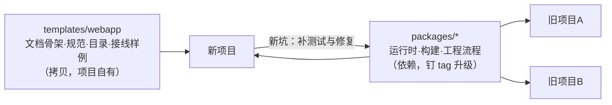

# nexus-kit 需求

> 基准：0.6.0 + task 使用诊断 / 2026-10-15

nexus-kit 是个人 Web App 的复用底座：把 旧项目A 与 旧项目B 两个项目各自做过一遍的 PWA、
升级检测、全屏与安全区、版本管理、部署、多 Agent 任务协作、工程纪律与活文档体系沉淀成**可依赖的包 + 可拷贝的
模板**，新项目从模板起步，踩到的新坑回 kit 修一次、所有项目升级依赖即得。

## 1. 背景与证据

两个项目在同一批问题上各写了一遍，且已经分叉——各自修过的坑没有流到对方：

| 能力 | 旧项目A | 旧项目B | 分叉点 |
|---|---|---|---|
| 升级状态机 | 新 worker statechange 主线 + updatefound 补挂 + controllerchange 补线；「他签已激活」判定；卡死 onFail 复位 | controllerchange 主线；跟随 installing 真实进度等待，无安装时 3 秒软限 | 各有对方没有的修复 |
| 版本比对 | version.json 带最近多版条目，跨版本聚合；同版本重发分「修复 / 内容有更新」 | 只比 gitHash 与版本号，只给当前版条目 | 旧项目A 更完整 |
| 音频恢复 | interrupted 态、statechange 兜底、resume 无效时重建 AudioContext（有上限） | 音效与 BGM 两套引擎各自 resume，无重建 | 经验单向流动 |
| SW 缓存 | generateSW + 按分区内容指纹换新运行时仓 | 手写 sw.ts，入口 NetworkFirst | 原则同、实现异 |
| 部署 | 自有服务器：原子切换、冒烟、自动回滚、缓存头预检 | Vercel | 目标不同 |
| 并行开发 | 工作树脚本、合入纪律、发版锁 | 仅 pre-commit | 只有 旧项目A 有 |

旧项目C 的实际研究任务使用已提交任务定义、固定起点工作树、agy 派发与原会话续跑、协调者独立复跑和审查后验收。parts-source 的首次执行与续跑保持同一会话，magic-table-rework 保存独立返工验收与集成记录。通用机制归 devflow；研究模型、原料与验证命令由宿主维护。

结论：再拷一份就是第三份分叉。**运行时与构建能力走依赖，文档与规则走拷贝**。

## 2. 范围：四层，按复用方式分

| 层 | 形态 | 内容 |
|---|---|---|
| 运行时 | `@nexus-kit/pwa`（框架无关）、`@nexus-kit/pwa-react`、`@nexus-kit/runtime`（框架无关） | SW 注册与检测链、升级状态机、版本比对、强制更新、`?nosw=1`、安装引导、离线补缓存、持久化存储申请；React 快照订阅与带重入闸的确认；日志（分区缓冲、跨会话保留、行式导出）、异常退出取证、诊断文件导出与白屏兜底、主包加载失败兜底、离开前限时保存；性能采集（水位长线、启动画像、帧统计）；图像资源（加载调度、关键闸门、解码位图缓存）；音频（解锁、回前台恢复与假死重建、音效与音乐播放） |
| 构建 | `@nexus-kit/vite` | `nexusPwa()`：版本注入、version.json、VitePWA 红线配置、运行时缓存分区与旧仓清理；`verifyPwaBuild()` 构建后门禁与预算 |
| 工程流程 | `@nexus-kit/devflow`（CLI `nexus-devflow`） | 活文档审计、CHANGELOG 提交门禁、git hooks、部署到自有服务器（冒烟 + 自动回滚）、nginx 样板、并行开发工作树（建/合/收/查，合入只快进）、发版一条命令与发版锁；多 Agent 任务生成、派发、状态查询、原会话续跑、正式返工、独立验证与审查后验收 |
| 模板 | `templates/webapp` | Vite + React + Tailwind + TS strict 应用骨架，接好上述三层；CLAUDE.md 与 docs 五层骨架；通用规范（文档写法、工程质量与交付、Web 运行时） |

不在范围：游戏专属能力（Pixi 纹理缓存、实体包驻留、触发表与距离衰减等）留在各自项目——通用的加载调度、图像缓存与音频播放归 `@nexus-kit/runtime`；托管平台适配
（Vercel 等）不做，部署目标为自有服务器 + nginx。

## 3. 裁决

- **底子取 旧项目A**，旧项目B补两处：升级时「探测落地后既无 installing 也无 waiting 即提前收口」
  （不陪跑到绝对兜底）；iOS 安装环境识别与安装引导。
- **prompt 制红线**：任何路径不得在用户未点击时刷新页面。无可装新 SW 时收口报原因，不盲刷
  （generateSW 的入口页由预缓存供给，盲刷只会回到旧壳）。新版本只在用户于升级弹窗里确认后接管，唯一例外是
  白屏兜底页（含主包加载失败的内联兜底）的「重新加载」：用户点了它，就先激活已下载好的新版本再刷新，不经升级
  弹窗、不跑升级前保存——这时应用已经起不来、升级弹窗不在、没有可保存的状态，而只刷新拿到的永远是坏的旧版。
- **弹窗时机由控制器快照表达**：检测命中即开；宿主可暂缓（专注流程不打断），解除时补开；
  「稍后」过的同一构建不再自动开，手动检查强制重开。
- **工程流程收一个包**：部署与文档/提交门禁读同一份 `nexus.config.json`，合在 devflow 里，
  不为部署单独建包。
- **任务协作是可选工程能力**：宿主显式配置执行器、目录、规则和预算。任务定义与人工进度保存于同一 Markdown；运行记录不充当第二套人工进度表。工具检测派发、续跑和复跑期间的主仓受跟踪文件、索引及 HEAD 变化；异常保留审计，协调者明确核对后才能继续验证与验收，正确内容可以保留。派发、续跑、验证与验收提示固定起点脱离主仓历史的风险，保留现场，不自动改写分支。待验收任务启动被拒时给出返工登记与后续命令；SHA-256 不符时打印期望值与实际值。执行者不能自验收，任务通过不自动合入、推送、发布或回收。只有真实验证过的 agy 适配器；不从模糊需求自动编造任务。
- **分发**：私有 GitHub 仓库 + git 子目录依赖钉 tag（`#v<版本>&path:/packages/<包>`）；
  `packages/*/dist` 入库，消费方安装不需要构建；包之间只用 peerDependencies 互引。
- **通用规范随模板拷贝**：规范是项目自有的活文档，会按项目长出自己的条款；kit 只维护模板
  里的起点版本，不反向同步到已生成的项目。

## 4. 验收

- kit：`pnpm check` 全绿（文档审计、lint、格式、类型、单测、包构建、dist 新鲜度、模板单测与
  模板构建含 verify-build）；产品源码覆盖率四项 ≥80%（`pnpm test:coverage`）。
- 任务：`pnpm test:task` 通过构建后的公开 CLI 验证真实临时 Git 仓库和独立工作树，覆盖失败、中断、原会话续跑、返工、定义变化、输入与产物漂移、独立审查要求、前置验收及树回收状态。task 构建产物由 c8 单独守四项覆盖率 ≥80%，不靠其他模块平均数过线。实际 agy 派发与同会话返工接续、实际宿主新任务另行验证。
- 真浏览器：`pnpm e2e` 跑通四条链。
  - 升级链：v1 被 SW 接管 → 服务器换新版 → 检查更新弹窗与条目正确 → 确认 → 下载 → 切换 → 刷新进新版 → 再查为最新；坏版本兜底页「重新加载」直接进修复版。
  - 日志与诊断：刷新保留上一会话 → 杀进程后判疑似异常 → 导出与复制 → 白屏兜底 → 主包加载失败兜底。
  - 图像资源：慢网下关键闸门、并发上限、同图只下一次、淘汰即关位图。
  - 音频：解锁补播、限频与发声上限、补播时限、假死重建续播。
- 生成：`pnpm init-app <目录>` 产出的项目 `pnpm install && pnpm check` 全绿。
- 真机：iPhone 与 Android 各装一次模板应用，过一遍安装、断网打开、升级、安全区；在系统设置里清掉站点数据，前后各导出一次
  诊断文件。Chromium 模拟不了的 iOS 音频场景（锁屏、切后台两次、来电、停麦）按[音频](../架构算法/音频.md) §6 的真机清单过。

## 5. 已知边界

- 老项目（旧项目A、旧项目B）不强制回迁，下次触及对应模块时顺手换成依赖。
- `@nexus-kit/runtime` 的接口按浏览器平台问题设计，还没有真实接入方用过；第一个接入方（旧项目C，或 旧项目A
  下次动到这些模块）接入时预留一次接口调整的窗口，0.x 阶段按《工程质量与交付规范》走破坏性次版本。
- iOS 上的音频恢复、诊断文件的分享与复制（尤其微信内）只在 Chromium 里自动化验证过，真机结论以真机清单为准。
- 工作树与发版只支持 macOS / Linux（回收时停服务依赖 `lsof`、`ps`）。
- 任务执行器当前只支持 agy。没有 task 段的宿主继续使用原有 devflow 命令。旧快照不自动迁移，工具检查审查材料而非审查者身份，不提供操作系统级权限隔离；CLI 等待结束不等于跨会话通知。
- 模板图标为占位图，生成后必须替换。
