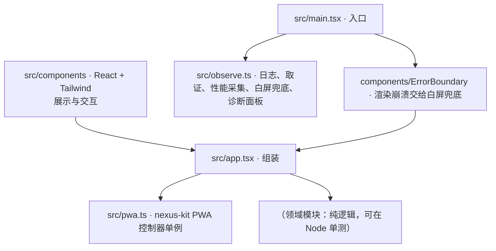

# 架构总览

> 基准： 0.7.0 / 2026-10-15

## 1. 分层

- `src/observe.ts` 是入口的第一个导入，赶在其他模块之前装好日志、异常退出取证、未捕获异常捕获、性能采集与
  白屏兜底；各模块经 `logs.log("模块名")` 记日志，经 `perf.registerGauge` 登记自己的指标。版本号连点 5 次打开
  诊断面板。`vite.config.ts` 往 `index.html` 注入主包加载失败的内联兜底，`observe.ts` 第一句 `markBooted()` 让它退出。

- 领域规则写成纯模块，不碰 DOM；组件只做展示与交互，不裁决规则。
- PWA、升级、部署、日志与诊断、性能采集、图像资源、音频的机制见 nexus-kit 的架构文档，本项目只记自己的取舍
  （§3、§4）。

## 2. 技术选型

- Vite + React 19 + Tailwind 4 + TypeScript strict；测试 vitest + happy-dom + Testing Library。
- PWA：vite-plugin-pwa（generateSW）经 `@nexus-kit/vite` 配置；部署到自有服务器 + nginx。
- 运行时基础设施：`@nexus-kit/runtime`（日志、取证与诊断、性能采集；用到图片或声音时加 `/assets`、`/audio`）。

## 3. 本项目的 PWA 取舍

- 运行时缓存分区：见 `pwa.config.ts`（无按需资源时为空）。
- 弹窗暂缓：（列出调用 `setPromptBlocked(true)` 的专注流程。）
- 升级前保存：（有本地数据时写明 `UpdateDialog` 的 `beforeUpgrade` 保存了什么。）

## 4. 本项目的运行时取舍

- 自定义性能指标：（列出经 `perf.registerGauge` 登记的指标与含义；没有就写「无」。）
- 图像与音频：（用了 `/assets`、`/audio` 时写明缓存预算、总线划分、`suspendWhenHidden` 取值与理由；没用就写「不用」。）

## 变更记录

- 2026-10-14 补运行时接线与运行时取舍（nexus-kit 0.6.0）。
- 2026-10-13 由 nexus-kit 模板生成。
