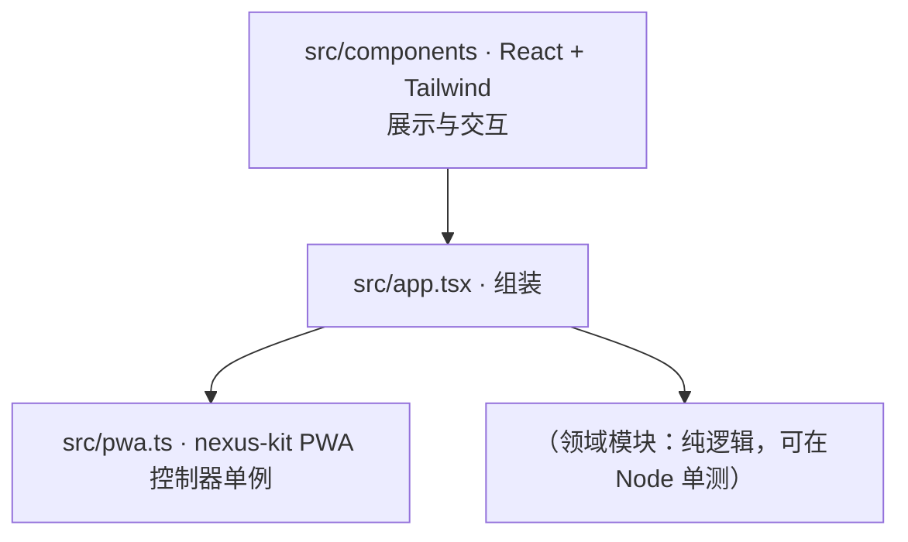

# 架构总览

> 基准： 0.1.0 / 2026-10-13

## 1. 分层

- 领域规则写成纯模块，不碰 DOM；组件只做展示与交互，不裁决规则。
- PWA、升级、部署机制见 nexus-kit《离线与升级》《部署与回滚》，本项目只记自己的取舍（运行时分区、
  弹窗暂缓点、升级前保存钩子）。

## 2. 技术选型

- Vite + React 19 + Tailwind 4 + TypeScript strict；测试 vitest + happy-dom + Testing Library。
- PWA：vite-plugin-pwa（generateSW）经 `@nexus-kit/vite` 配置；部署到自有服务器 + nginx。

## 3. 本项目的 PWA 取舍

- 运行时缓存分区：见 `pwa.config.ts`（无按需资源时为空）。
- 弹窗暂缓：（列出调用 `setPromptBlocked(true)` 的专注流程。）
- 升级前保存：（有本地数据时写明 `UpdateDialog` 的 `beforeUpgrade` 保存了什么。）

## 变更记录

- 2026-10-13 由 nexus-kit 模板生成。
